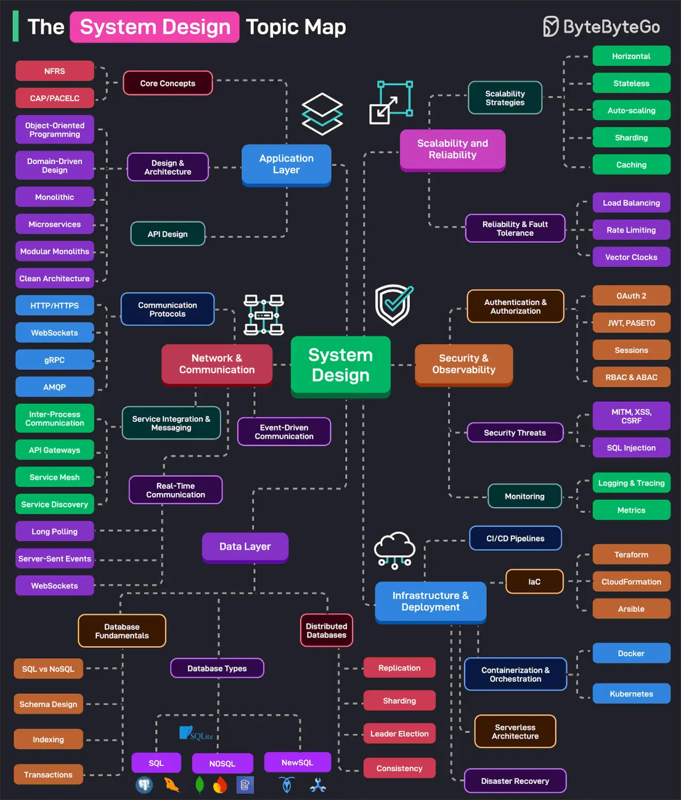

# 076 - The System Design Topic Map

- Source: ByteByteGo Big Archive System Design 2025
- PDF pages: 162-163
- Figures: 1

## Figures

## Original Extracted Text

Effective system design is a game of trade-offs and requires a broad knowledge base to make the
best decisions. This topic map categorizes the essential system design topics based on categories.

   1. Application Layer: It consists of the core concepts such as availability, scalability, reliability,
       and other NFRs. Also covers design and architectural topics such as OOP, DDD,
       Microservices, Clean Architecture, Modular Monoliths, and so on.

   2. Network & Communication: It covers communication protocols, service integration,
       messaging, real-time communication, and event-driven architecture.

    3. Data Layer: It covers the basics of database systems (schema design, indexing, SQL vs
        NoSQL, transactions, etc), the various types of databases, and the nuances of distributed
        databases (replication, sharding, leader election, etc.)

    4. Scalability & Reliability: This covers scalability strategies (horizontal, stateless, caching,
        partitioning, etc) and reliability strategies like load balancing, rate limiting, and so on.

    5. Security & Observability: It covers authentication and authorization techniques (OAuth 2,
        JWT, PASETO, Sessions, Cookies, RBAC, etc.) and security threats. The observability area
        deals with topics like monitoring, tracing, and logging.

    6. Infrastructure & Deployments: Deals with CI/CD pipelines, containerization and
        orchestration, serverless architecture, IaC, and disaster recovery techniques.

Over to you: What else will you add to the list?
