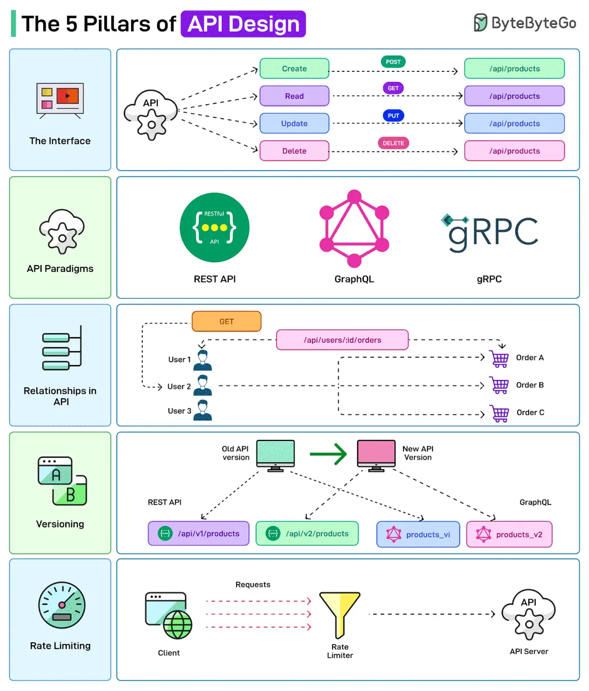

# 079 - The 5 Pillars of API Design

- Source: ByteByteGo Big Archive System Design 2025
- PDF pages: 168-169
- Figures: 1

## Figures

## Original Extracted Text

APIs are the backbone of modern systems. But it is also important to design them in the right way.

Here are a few things that a developer should consider while designing APIs

   1. The Interface
       API Design is concerned with defining the inputs and outputs of an API. For example,
       defining how the CRUD operations may be exposed to the user or the client.

   2. API Paradigms
       APIs can be built following different paradigms, each with its own set of protocols and
       standards. Some options are REST, GraphQL, and gRPC.

   3. Relationships in API
       APIs often need to establish relationships between the various entities. For example, a user
       might have multiple orders related to their account. The API endpoints should reflect these
       relationships for a better client experience.

   4. Versioning
       When modifying API endpoints, proper versioning and supporting backward compatibility are
       important.

   5. Rate Limiting
       Rate limiting is used to control the number of requests a user can make to an API within a
       certain timeframe. This is crucial for maintaining the reliability and availability of the API.

Over to you: Which other API Design principle will you add to the list?
