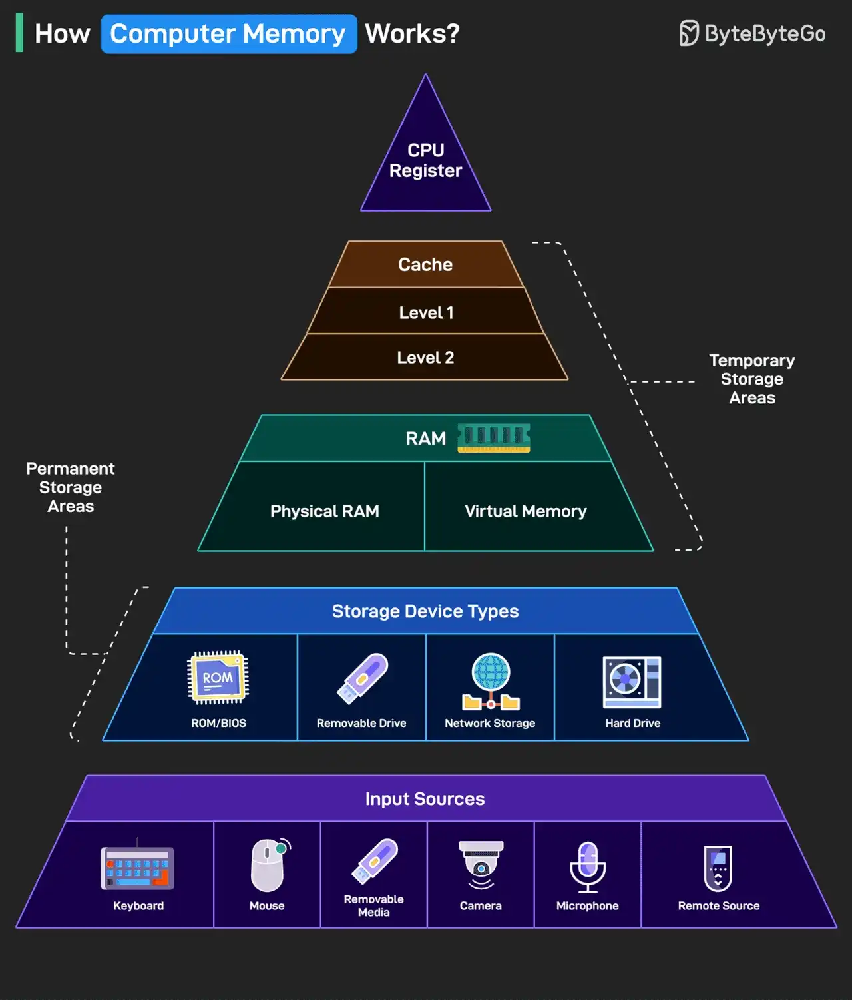

# 080 - How Computer Memory Works?

- Source: ByteByteGo Big Archive System Design 2025
- PDF pages: 170-171
- Figures: 1

## Figures

## Original Extracted Text

Here's a simple breakdown that shows how data moves through a system from input to processing
to storage.

   1. Data enters through input sources like keyboard, mouse, camera, or remote systems.

   2. Permanent storage holds your system files, apps, and media. This includes hard drives, USB
       drives, ROM/BIOS, and network-based storage.

   3. RAM is the workspace of your computer. It includes physical memory and virtual memory,
       which temporarily store data and programs while you're using them.

   4. Cache memory sits closer to the CPU and is split into Level 1 and Level 2. It helps speed up
       access to frequently used data.

   5. CPU registers are the fastest and smallest memory units. They're used directly by the
       processor to execute instructions almost instantly.

The higher you go in the memory pyramid, the faster and smaller the storage.

Over to you: What else will you add to improve the understanding of a computer memory's working?
