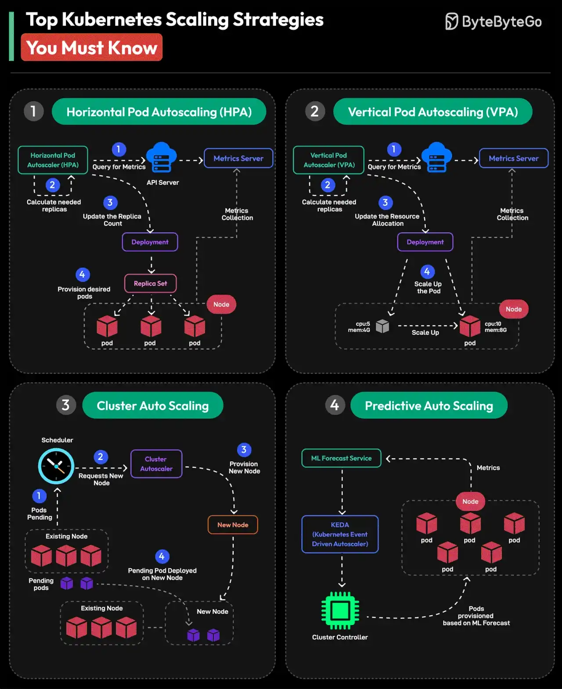

# 081 - Top Kubernetes Scaling Strategies You Must Know

- Source: ByteByteGo Big Archive System Design 2025
- PDF pages: 172-173
- Figures: 1

## Figures

## Original Extracted Text

1. Horizontal Pod Autoscaling or HPA
     Horizontal Pod Autoscaler automatically scales the number of Pods in a Deployment,
     ReplicaSet, or StatefulSet based on observed CPU utilization, memory usage, or custom
     metrics.

 2. Vertical Pod Autoscaling or VPA
     Based on application requirements, VPA adjusts the resources allocated to individual pods,
     such as CPU and memory. This approach dynamically changes pod resource settings based
     on workload metrics.

   3. Cluster Auto Scaling
       The Cluster Autoscaler automatically adjusts the number of nodes in a Kubernetes cluster. It
       interacts with the cloud provider to add or remove nodes based on requirements. This is
       important to maintain a balanced cluster.

   4. Predictive Auto Scaling
       Predictive Autoscaling uses machine learning to forecast future resource requirements. It
       helps Kubernetes adjust resources by anticipating workload demands.

Over to you: Which other Kubernetes Scaling Strategy will you add to the list?
