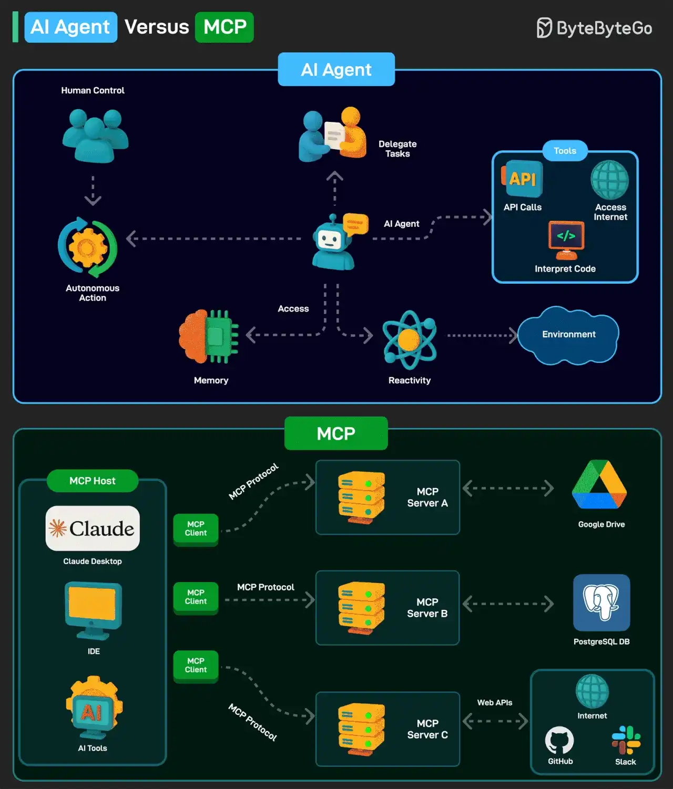

# 082 - AI Agent versus MCP

- Source: ByteByteGo Big Archive System Design 2025
- PDF pages: 174-175
- Figures: 1

## Figures

## Original Extracted Text

An AI agent is a software program that can interact with its environment, gather data, and use that
data to achieve predetermined goals. AI agents can choose the best actions to perform to meet
those goals.

Key characteristics of AI agents are as follows:

   1. An agent can perform autonomous actions without constant human intervention. Also, they
       can have a human in the loop to maintain control.

   2. Agents have a memory to store individual preferences and allow for personalization. It can
       also store knowledge. An LLM can undertake information processing and decision-making
       functions.

   3. Agents must be able to perceive and process the information available from their
       environment.

Model Context Protocol (MCP) is a new system introduced by Anthropic to make AI models more
powerful.

It is an open standard that allows AI models (like Claude) to connect to databases, APIs, file
systems, and other tools without needing custom code for each new integration.

MCP follows a client-server model with 3 key components:

   1. Host: AI applications like Claude

   2. MCP Client: Component inside an AI model (like Claude) that allows it to communicate with
       MCP servers

   3. MCP Server: Middleman that connects an AI model to an external system

Over to you: Have you used AI Agents or MCP?
