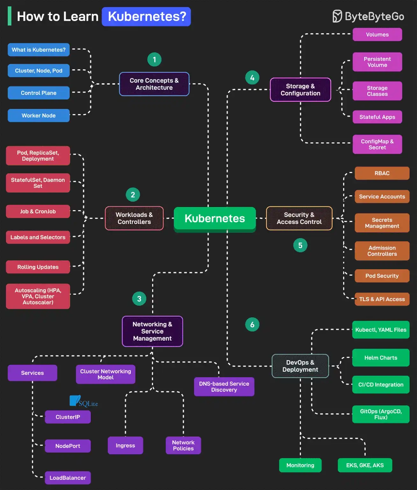

# 084 - How to Learn Kubernetes?

- Source: ByteByteGo Big Archive System Design 2025
- PDF pages: 178-179
- Figures: 1

## Figures

## Original Extracted Text

Kubernetes is an open-source container orchestration platform that automates the deployment,
scaling, and management of containerized applications.

   1. Core Concepts and Architecture
       This includes topics like What is Kubernetes, Cluster, Node, Pod, Control Plane, and Worker
       Node.

   2. Workloads and Controllers
       This includes topics like Pod, ReplicaSet, Deployment, StatefulSet, Job, CronJob, Labels,
       Selectors, and Autoscalers (HPA, VPA, and Cluster Autoscaler).

   3. Networking and Service Management
       This involves topics like Cluster Networking Model, Services (ClusterIP, NodePort,
       LoadBalancer), Ingress, and Network Policies.

   4. Storage and Configuration
       This includes topics like Volumes, PersistentVolume, PersistentVolumeClaim, Storage
       Classes, ConfigMap, Secret, and Stateful Applications.

   5. Security & Access Control
       This involves topics like RBAC, Service Accounts, Secrets Management, Admission
       Controllers, Pod Security, TLS, and API Access.

   6. Tools, Observability & Ecosystem
       This includes topics like kubectl, YAML files, Helm Charts, CI/CD Integration, GitOps,
       Logging, Monitoring, and EKS.

Over to you: What else will you add to the list for learning Kubernetes?
