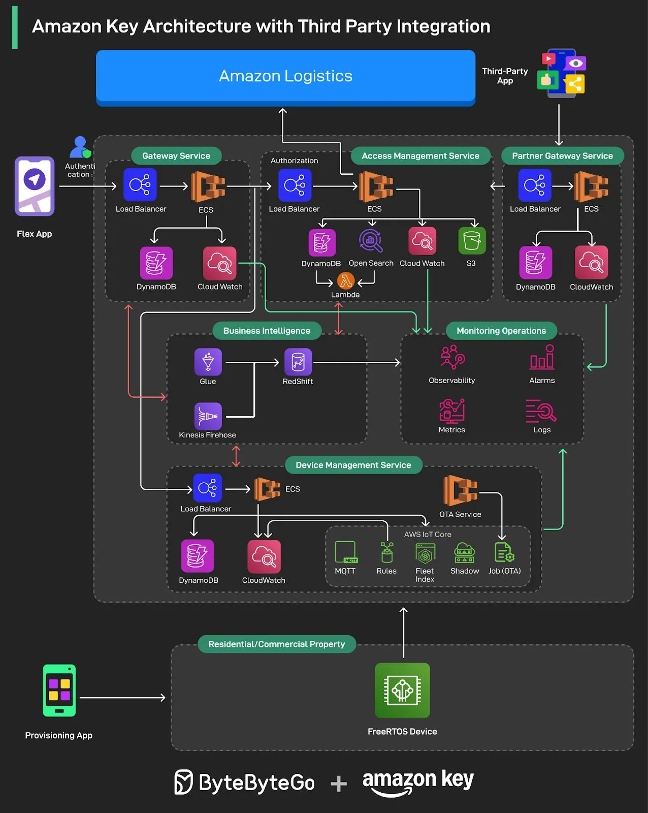

# 086 - Amazon Key Architecture with Third Party Integration

- Source: ByteByteGo Big Archive System Design 2025
- PDF pages: 182-183
- Figures: 1

## Figures

## Original Extracted Text

Amazon Key is a REALLY convenient way to have your packages securely delivered right inside
your garage or multifamily property.

We sat down with Kaushik Mani and Vijayakrishnan Nagarajan to learn how a small side project
evolved into a global platform: now powering over 100 million secure door unlocks every year.

This story is packed with valuable lessons on:

   ● Scaling IoT infrastructure across thousands of locations

   ● Building resilient, field-ready hardware for real-world environments

   ● Overcoming cold starts and connectivity challenges

   ● Designing a microservices architecture for global expansion

   ● Creating a secure, partner-ready platform to support third-party integrations

   ● And many more
