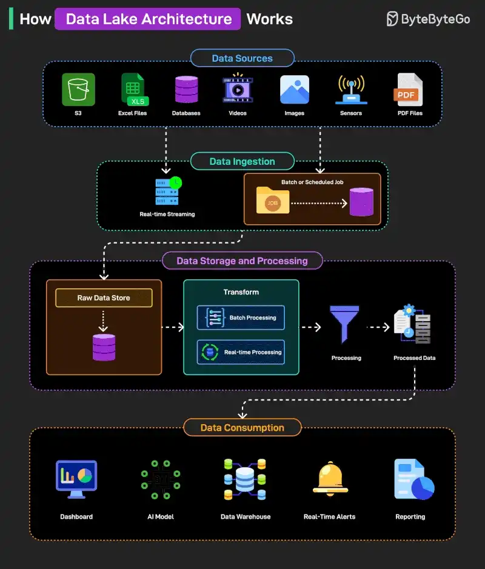

# 089 - How Data Lake Architecture Works?

- Source: ByteByteGo Big Archive System Design 2025
- PDF pages: 188-189
- Figures: 1

## Figures

## Original Extracted Text

A data lake is a centralized storage system that holds large volumes of structured, semi-structured,
and unstructured data in its raw form. It allows organizations to store data at scale and process it
later for different requirements.

Here's how it works on a high level:

   1. Data from diverse sources like S3, Excel files, databases, videos, images, sensors, and
       PDFs is collected for ingestion.

   2. Ingestion happens via real-time streaming or batch/scheduled jobs, depending on the data
       type and source.

   3. Ingested data is first stored in a raw data store before any transformation or processing
       occurs.

   4. Data is then processed through batch or real-time processing systems to clean, transform,
       and prepare it for use.

   5. The processed data is stored and made ready for downstream consumption by various tools
       and platforms.

   6. Final data consumption happens through dashboard, AI models, data warehouse, real-time
       alerts, and reporting systems.

Over to you: What else will you add to better understand the Data Lake Architecture?
