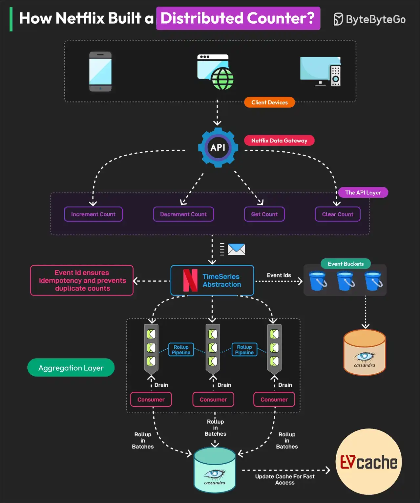
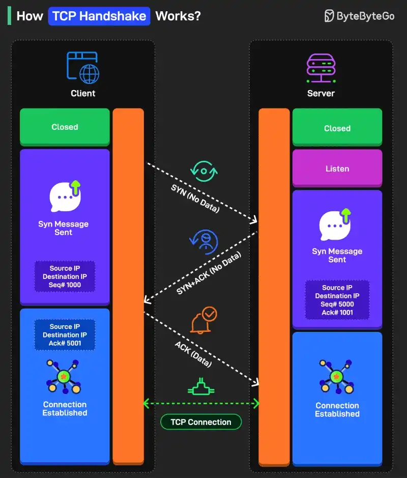

# 090 - How Netflix Built a Distributed Counter

- Source: ByteByteGo Big Archive System Design 2025
- PDF pages: 190-193
- Figures: 2

## Figures

## Original Extracted Text

The Netflix distributed counter is a masterclass for learning system design.

A Distributed Counter is a system where the responsibility of counting events is spread across
multiple servers or nodes in a network. Netflix needs to track and measure multiple user interactions
to make real-time decisions and optimize its infrastructure.

For this reason, they built a Distributed Counter Abstraction.

Netflix's Distributed Counter Abstraction operates in four main layers, ensuring high performance,
scalability, and eventual consistency.

   1. Client API Layer
       Users interact with the system by sending AddCount, GetCount, or ClearCount requests.
       The Netflix Data Gateway efficiently processes and routes these requests.

   2. Event Logging and TimeSeries Storage
       Events are stored in Netflix TimeSeries Abstraction for scalability. Each event is tagged with
       an Event ID to ensure idempotency. To avoid database contention, events are grouped into
       time partitions known as buckets. Data is stored in Cassandra.

   3. Rollup Pipeline or Aggregation
       Rollup Queues collect event changes and process them in batches. Aggregation occurs in
       immutable time windows, ensuring accurate rollup calculations. Data is stored in the
       Cassandra Rollup Store for eventual consistency.

   4. Read Optimization (Cache & Query Handling)
       Aggregated counter values are cached in EVCache for ultra-fast reads. If a cache value is
       stale, a background rollup refresh updates it. This model allows Netflix to process 75K
       requests per second with single-digit millisecond latency.

Reference: Netflix's Distributed Counter Abstraction

How TCP Handshake Works?

There are three steps in the handshake process:

   1. SYN (Synchronize)
       Think of it as one party extending its hand for a handshake. The process starts with the client
       sending a TCP segment to the server with the SYN flag. Also, an initial sequence number
       (ISN) is sent along with the message.

   2. SYN-ACK
       This is like the second party agreeing to the handshake. The server receives the SYN
       segment and responds by sending a TCP segment to the client. It sets the SYN flag and the

       ACK flag in the segment. The ACK flag is meant to acknowledge the receipt of the client's
       SYN segment by incrementing the ISN.

   3. ACK
       This is where the two parties shake hands. The client receives the SYN-ACK segment and
       acknowledges the server's response by sending another TCP segment with the ACK flag
       set. The sequence number is set to the server's ISN after incrementing.

Some more points worth considering:

   1. SYN and ACK are control flags used to manage different aspects of the communication
       process.

   2. Sequence numbers (ISN) help the client and server keep track of the message order so that
       nothing gets missed.

Over to you: What else will you add to understand the TCP Handshake process in a better way?
