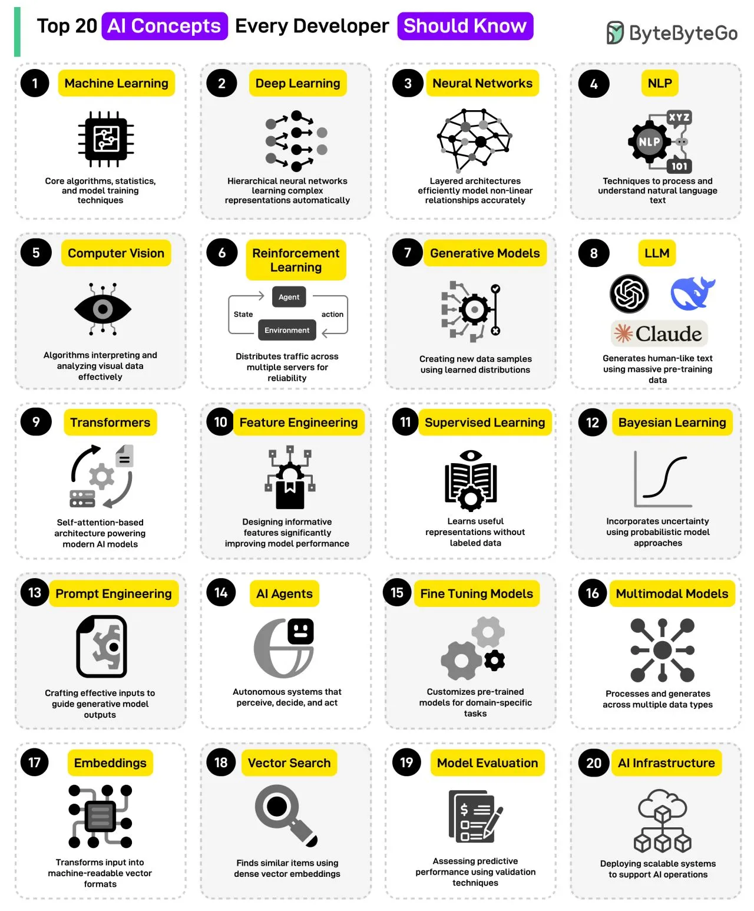

# 091 - Top 20 AI Concepts You Should Know

- Source: ByteByteGo Big Archive System Design 2025
- PDF pages: 194-195
- Figures: 1

## Figures

## Original Extracted Text

1. Machine Learning: Core algorithms, statistics, and model training techniques.

 2. Deep Learning: Hierarchical neural networks learning complex representations automatically.

 3. Neural Networks: Layered architectures efficiently model nonlinear relationships accurately.

 4. NLP: Techniques to process and understand natural language text.

 5. Computer Vision: Algorithms interpreting and analyzing visual data effectively

 6. Reinforcement Learning: Distributed traffic across multiple servers for reliability.

 7. Generative Models: Creating new data samples using learned data.

   8. LLM: Generates human-like text using massive pre-trained data.

   9. Transformers: Self-attention-based architecture powering modern AI models.

   10.Feature Engineering: Designing informative features to improve model performance
       significantly.

   11. Supervised Learning: Learns useful representations without labeled data.

   12.Bayesian Learning: Incorporate uncertainty using probabilistic model approaches.

   13.Prompt Engineering: Crafting effective inputs to guide generative model outputs.

   14.AI Agents: Autonomous systems that perceive, decide, and act.

   15.Fine-Tuning Models: Customizes pre-trained models for domain-specific tasks.

   16.Multimodal Models: Processes and generates across multiple data types like images, videos,
       and text.

   17.Embeddings: Transforms input into machine-readable vector formats.

   18.Vector Search: Finds similar items using dense vector embeddings.

   19.Model Evaluation: Assessing predictive performance using validation techniques.

   20.AI Infrastructure: Deploying scalable systems to support AI operations.

Over to you: Which other AI concept will you add to the list?
