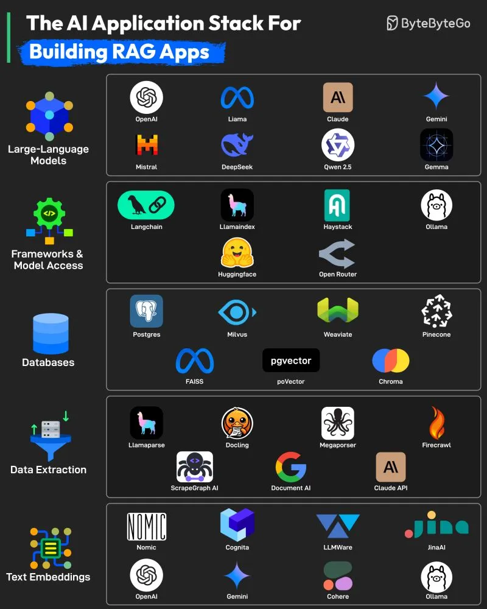

# 092 - The AI Application Stack for Building RAG Apps

- Source: ByteByteGo Big Archive System Design 2025
- PDF pages: 196-197
- Figures: 1

## Figures

## Original Extracted Text

1. Large Language Models
     These are the core engines behind Retrieval-Augmented Generation (RAG), responsible for
     understanding queries and generating coherent and contextual responses. Some common
     LLM options are OpenAI GPT models, Llama, Claude, Gemini, Mistral, DeepSeek, Qwen
     2.5, Gemma, etc.

 2. Frameworks and Model Access
     These tools simplify the integration of LLMs into your applications by handling prompt
     orchestration, model switching, memory, chaining, and routing. Common tools are
     Langchain, LlamaIndex, Haystack, Ollama, Hugging Face, and OpenRouter.

   3. Databases
       RAG applications rely on storing and retrieving relevant information. These vector databases
       are optimized for similarity search, while relational options like Postgres offer structured
       storage. Tools are Postgres, FAISS, Milvus, pgVector, Weaviate, Pinecone, Chroma, etc.

   4. Data Extraction
       To populate your knowledge base, these tools help extract structured information from
       unstructured sources like PDFs, websites, and APIs. Some common tools are Llamaparse,
       Docking, Megaparser, Firecrawl, ScrapeGraph AI, Document AI, and Claude API.

   5. Text Embeddings
       Embeddings convert text into high-dimensional vectors that enable semantic similarity
       search, which is a critical step for connecting queries with relevant context in RAG. Common
       tools are Nomic, OpenAI, Cognita, Gemini, LLMWare, Cohere, JinaAI, and Ollama.

Over to you: What else will you add to the list to build RAG apps?
