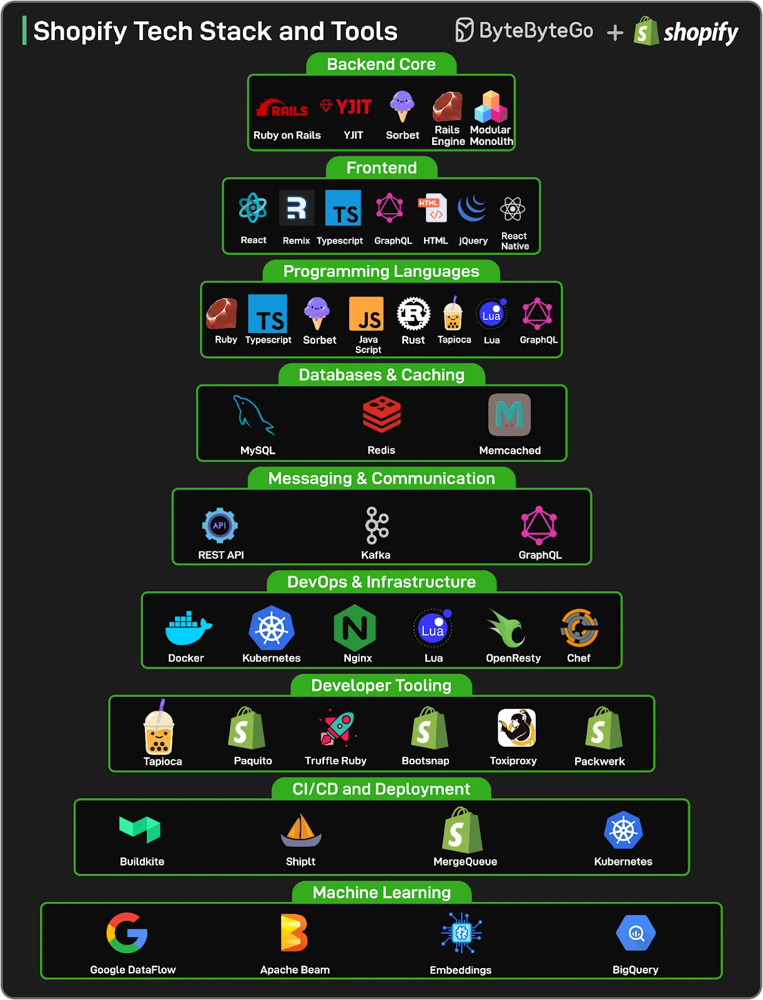

# 093 - Shopify Tech Stacks and Tools

- Source: ByteByteGo Big Archive System Design 2025
- PDF pages: 198-199
- Figures: 2

## Figures

## Original Extracted Text

Shopify handles scale that would break most systems.

On a single day (Black Friday 2024), the platform processed 173 billion requests, peaked at 284
million requests per minute, and pushed 12 terabytes of traffic every minute through its edge.

These numbers aren't anomalies. They're sustained targets that Shopify strives to meet. Behind this
scale is a stack that looks deceptively simple from the outside: Ruby on Rails, React, MySQL, and
Kafka.

But that simplicity hides sharp architectural decisions, years of refactoring, and thousands of
deliberate trade-offs.

In this newsletter, we map the tech stack powering Shopify from:

    ● the modular monolith that still runs the business,

    ● to the pods that isolate failure domains,

    ● to the deployment pipelines that ship hundreds of changes a day.

    ● It covers the tools, programming languages, and patterns Shopify uses to stay fast, resilient,
       and developer-friendly at incredible scale.

A huge thank you to Shopify's world-class engineering team for sharing their insights and for

🔗
collaborating with us on this deep technical exploration.
    Dive into the full newsletter here.
