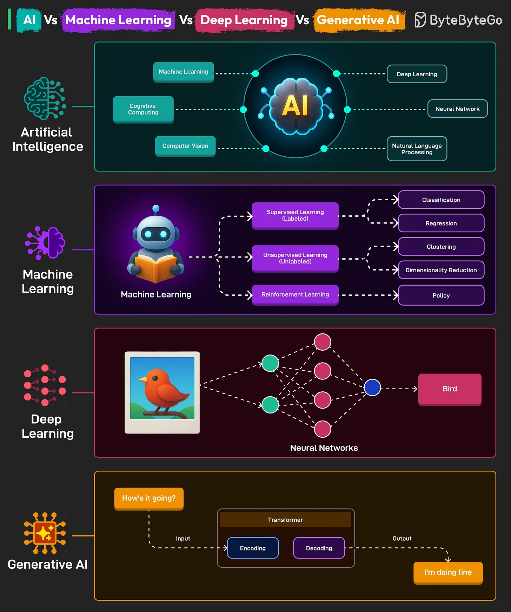

# 094 - AI Vs Machine Learning Vs Deep Learning Vs Generative AI

- Source: ByteByteGo Big Archive System Design 2025
- PDF pages: 200-201
- Figures: 1

## Figures

## Original Extracted Text

1. Artificial Intelligence (AI)
     It is the overarching field focused on creating machines or systems that can perform tasks
     typically requiring human intelligence, such as reasoning, learning, problem-solving, and
     language understanding. AI consists of various subfields, including ML, NLP, Robotics, and
     Computer Vision

 2. Machine Learning (ML)
     It is a subset of AI that focuses on developing algorithms that enable computers to learn from
     and make decisions based on data.

       Instead of being explicitly programmed for every task, ML systems improve their
       performance as they are exposed to more data. Common applications include spam
       detection, recommendation systems, and predictive analytics.

   3. Deep Learning
       It is a specialized subset of ML that utilizes artificial neural networks with multiple layers to
       model complex patterns in data.
       Neural networks are computational models inspired by the human brain's network of
       neurons. Deep neural networks can automatically discover representations needed for future
       detection. Use cases include image and speech recognition, NLP, and autonomous vehicles.

   4. Generative AI
       It refers to AI systems capable of generating new content, such as text, images, music, or
       code, that resembles the data they were trained on. They rely on the Transformer
       Architecture.
       Notable generative AI models include GPT for text generation and DALL-E for image
       creation.

Over to you: What else will you add to understand these concepts better?
