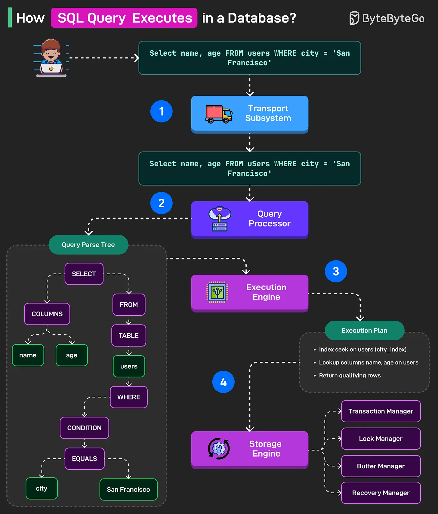

# 095 - How SQL Query Executes In A Database?

- Source: ByteByteGo Big Archive System Design 2025
- PDF pages: 202-203
- Figures: 1

## Figures

## Original Extracted Text

STEP 1

The query string first reaches the Transport Subsystem of the database. This subsystem manages
the connection with the client. Also, it performs authentication and authorization checks, and if
everything looks fine, it lets the query go to the next step.

STEP 2

The query now reaches the Query Processor subsystem, which has two parts: Query Parser and
Query Optimizer.

The Query Parser breaks down the query into sub-parts (such as SELECT, FROM, WHERE). It
checks for any syntax errors and creates a parse tree.

Then, the Query Optimizer goes through the parse tree, checks for semantic errors (for example, if
the "users" table exists or not), and finds out the most efficient way to execute the query.

The output of this step is the execution plan.

STEP 3

The execution plan goes to the Execution Engine. This plan is made up of all the steps needed to
execute the query.

The Execution Engine takes this plan and coordinates the execution of each step by calling the
Storage Engine. It also collects the results from each step and returns a combined or unified
response to the upper layer.

STEP 4

The Execution Engine sends low-level read and write requests to the Storage Engine based on the
execution plan.

This is handled by the various components of the Storage Engine, such as the transaction manager
(for transaction management), lock manager (acquires necessary locks), buffer manager (checks if
data pages are in memory), and recovery manager (for rollback or recovery).

Over to you: What else will you add to understand the execution of an SQL Query?
