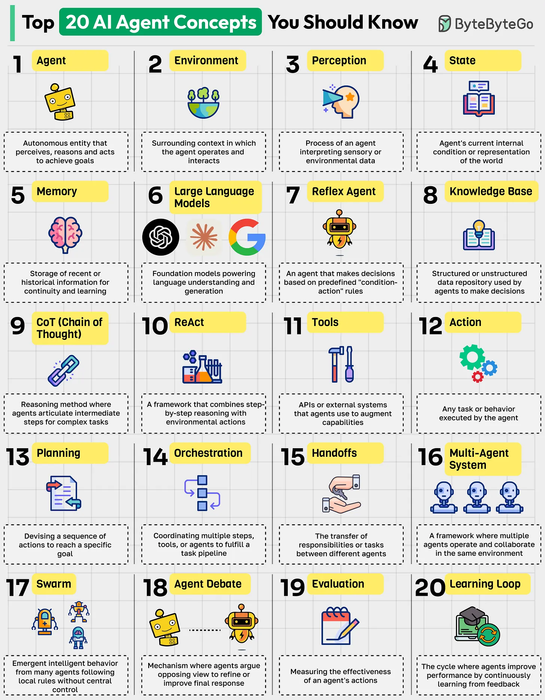

# 096 - Top 20 AI Agent Concepts You Should Know

- Source: ByteByteGo Big Archive System Design 2025
- PDF pages: 204-205
- Figures: 1

## Figures

## Original Extracted Text

1. Agent: An autonomous entity that perceives, reasons, and acts in an environment to achieve
     goals.

 2. Environment: The surrounding context or sandbox in which the agent operates and interacts.

 3. Perception: The process of interpreting sensory or environmental data to build situational
     awareness.

 4. State: The agent's current internal condition or representation of the world.

   5. Memory: Storage of recent or historical information for continuity and learning.

   6. Large Language Models: Foundation models powering language understanding and
       generation.

   7. Reflex Agent: A simple type of agent that makes decisions based on predefined
       "condition-action" rules.

   8. Knowledge Base: Structured or unstructured data repository used by agents to inform
       decisions.

   9. CoT (Chain of Thought): A reasoning method where agents articulate intermediate steps for
       complex tasks.

   10.ReACT: A framework that combines step-by-step reasoning with direct environmental
       actions.

   11. Tools: APIs or external systems that agents use to augment their capabilities.

   12.Action: Any task or behavior executed by the agent as a result of its reasoning.

   13.Planning: Devising a sequence of actions to reach a specific goal.

   14.Orchestration: Coordinating multiple steps, tools, or agents to fulfill a task pipeline.

   15.Handoffs: The transfer of responsibilities or tasks between different agents.

   16.Multi-Agent System: A framework where multiple agents operate and collaborate in the same
       environment.

   17.Swarm: Emergent intelligent behavior from many agents following local rules without central
       control.

   18.Agent Debate: A mechanism where agents argue opposing views to refine or improve
       outcomes.

   19.Evaluation: Measuring the effectiveness or success of an agent's actions and outcomes.

   20.Learning Loop: The cycle where agents improve performance by continuously learning from
       feedback or outcomes.

Over to you: Which other AI agent concept will you add to the list?
