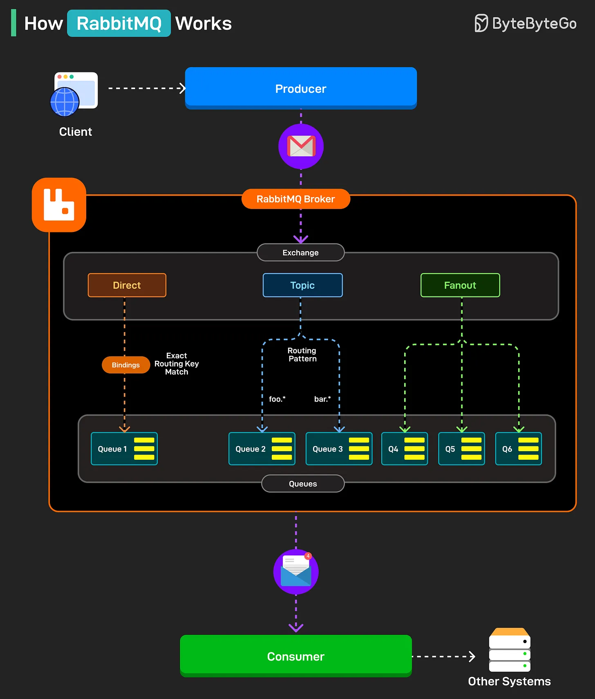

# 097 - How RabbitMQ Works?

- Source: ByteByteGo Big Archive System Design 2025
- PDF pages: 206-207
- Figures: 1

## Figures

## Original Extracted Text

RabbitMQ is a message broker that enables applications to communicate by sending and receiving
messages through queues. It helps decouple services, improve scalability, and handle asynchronous
processing efficiently.

Here's how it works:

   1. A producer (usually an application or service) sends messages to the RabbitMQ broker,
       which manages message routing and delivery.

   2. Within the broker, messages are sent to an exchange, which determines how they should be
       routed based on the type of exchange: Direct, Topic, or Fanout.

   3. Bindings connect exchanges to queues using a binding key, which defines the rules for
       routing messages (for example, exact match or pattern-based)

   4. Direct exchanges route messages to queues that match the routing key exactly, as shown
       with Queue 1.

   5. Topic exchanges use patterns to route messages to matching queues.

   6. Fanout exchanges broadcast messages to all bound queues, regardless of routing keys.

   7. Finally, messages are pulled from the queues by a consumer, which processes them and
       can pass the results to other systems.

Over to you: What else will you add to the RabbitMQ process flow?
