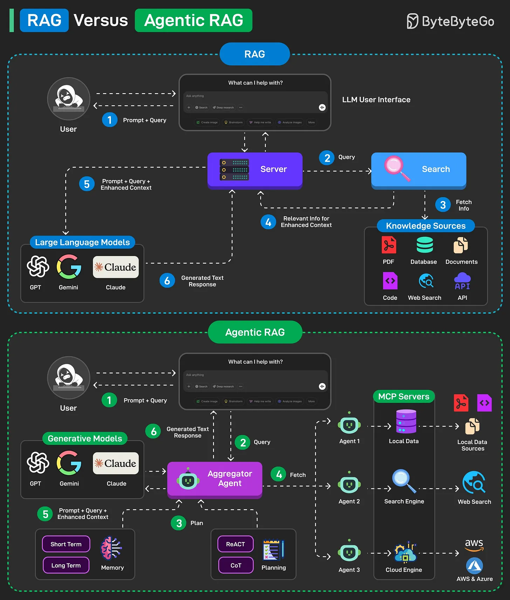

# 098 - RAG vs Agentic RAG

- Source: ByteByteGo Big Archive System Design 2025
- PDF pages: 208-209
- Figures: 1

## Figures

## Original Extracted Text

RAG (Retrieval Augmented Generation) is a method that combines information retrieval with large
language models to generate answers. Here's how RAG works on a high level:

   1. The model retrieves relevant data from data sources and then extracts it to a vector
       database from the pre-indexed model.

   2. Augment the prompts by retrieving information and merging it with the query prompt.

   3. A Large Language Model (like GPT, Claude, or Gemini) understands the combined query
       and generates the final response.

A traditional RAG has a simple retrieval, limited adaptability, and relies on static knowledge, making
it less flexible for dynamic and real-time information.

Agentic RAG improves on this by introducing AI agents that can make decisions, select tools, and
even refine queries for more accurate and flexible responses. Here's how Agentic RAG works on a
high level:

   1. The user query is directed to an AI Agent for processing.

   2. The agent uses short-term and long-term memory to track query context. It also formulates a
       retrieval strategy and selects appropriate tools for the job.

   3. The data fetching process can use tools such as vector search, multiple agents, and MCP
       servers to gather relevant data from the knowledge base.

   4. The agent then combines retrieved data with a query and system prompt. It passes this data
       to the LLM.

   5. LLM processes the optimized input to answer the user's query.

Over to you: What else will you add to better understand RAG vs Agentic RAG?
