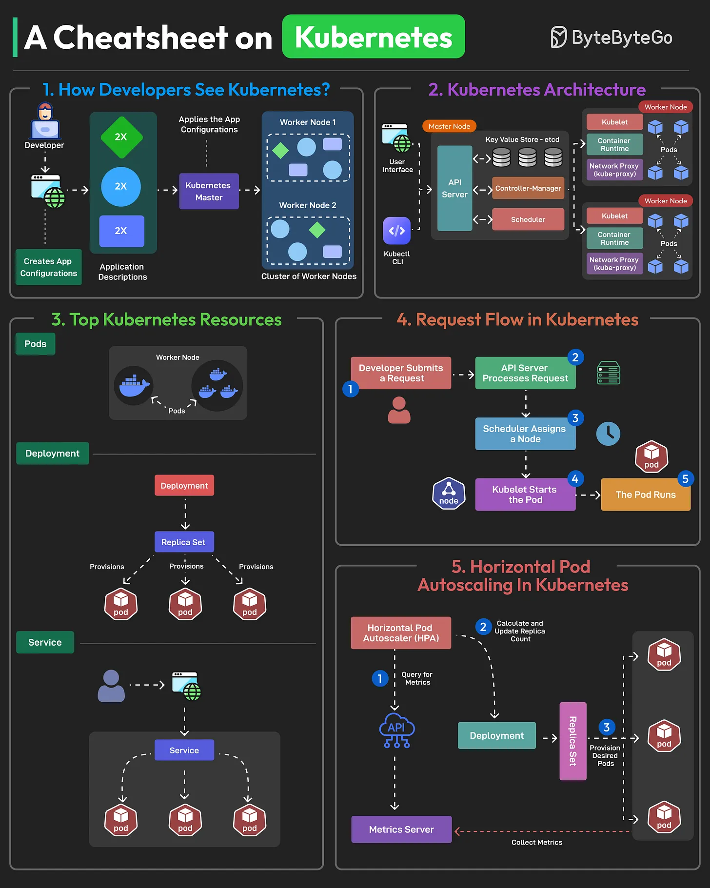

# 099 - A Cheatsheet on Kubernetes

- Source: ByteByteGo Big Archive System Design 2025
- PDF pages: 210-211
- Figures: 1

## Figures

## Original Extracted Text

Kubernetes (K8S) is an open-source container orchestration platform originally developed by Google
and now maintained by the Cloud Native Computing Foundation (CNCF).

Developers working with Kubernetes create manifest files that describe their application and specify
the number of instances, resource requirements, and other configurations.

Kubernetes operates using a control pane and a group of nodes.
The control plane is deployed on the master node and manages the overall state of the cluster. It
consists of components like API Server, Etcd, Controller Manager, and Scheduler.

Nodes are the workers in a Kubernetes cluster. Each node contains components like the Kubelet
and Kube-proxy and is responsible for running the containerized applications.

Some top Kubernetes resources are Pods, Deployments, Services, and Persistent Volumes.

   1. Pods encapsulate one or more containers.

   2. Deployment is a higher-level abstraction that manages Pods.

   3. Service is an abstraction that provides a stable way to expose and access a set of Pods.

   4. Volume is a storage resource that helps retain data between pod restarts or recreations.

The Horizontal Pod Autoscaler helps scale the number of Pods in a Deployment, ReplicaSet, or
StatefulSet based on observed CPU utilization, memory usage, or custom metrics. It monitors
resource usage and adjusts the number of replicas to match the desired resource targets.

Over to you: Have you used Kubernetes in your projects?
