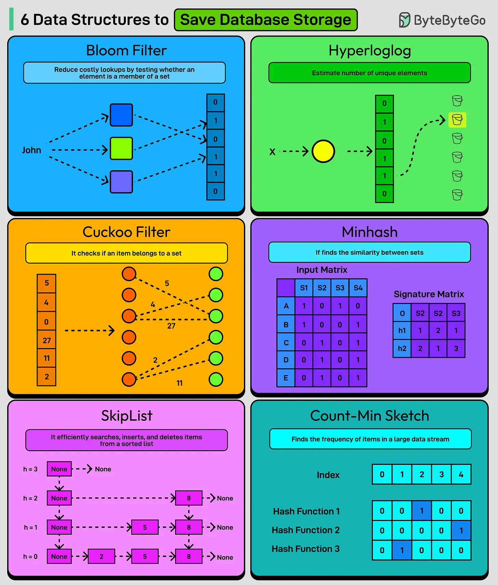

# 100 - 6 Data Structures to Save Storage

- Source: ByteByteGo Big Archive System Design 2025
- PDF pages: 212-213
- Figures: 1

## Figures

## Original Extracted Text

1. Bloom Filter
     A probabilistic data structure used to test whether an element is a member of a set.

 2. HyperLogLog
     An algorithm that approximates the number of unique elements in a multi-set using minimal
     memory.

 3. Cuckoo Filter
     A space-efficient alternative to Bloom filters that supports deletion and has better lookup
     performance.

    4. Minhash
        A technique for quickly estimating the similarity between large sets using compressed hash
        signatures.

    5. SkipList
        A layered linked list structure that allows fast search, insert, and delete operations.

    6. Count-Min Sketch
        A probabilistic data structure that approximates the frequency of items in a large data stream

Over to you: Which other data structure will you add to the list?
