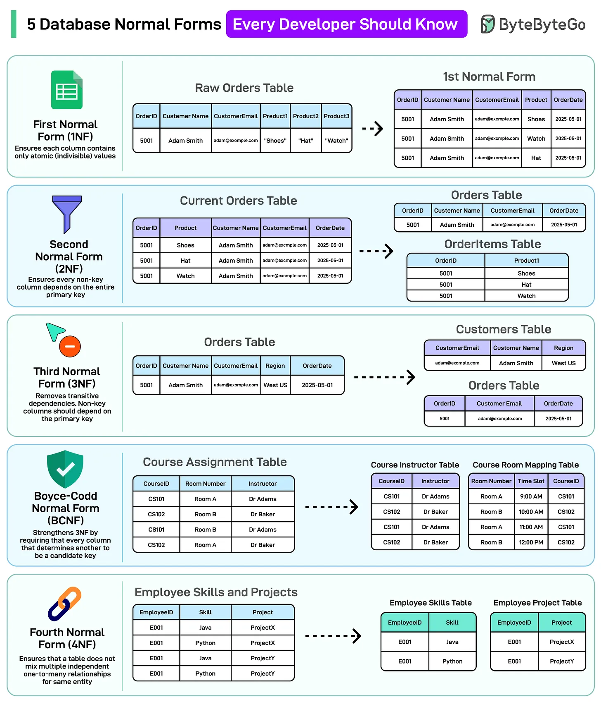
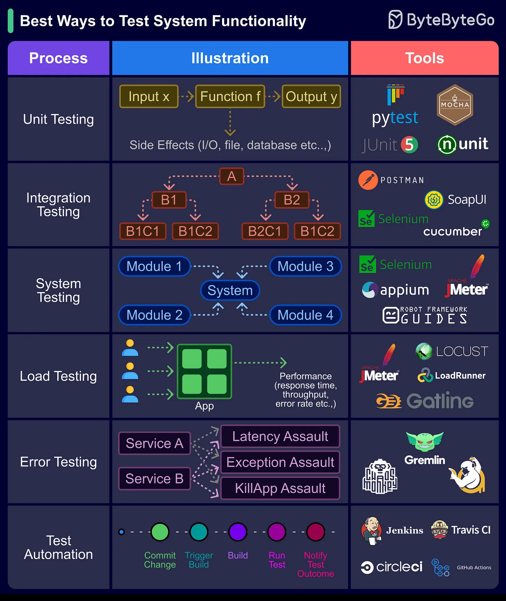

# 101 - 5 Database Normal Forms Every Developer Should Know

- Source: ByteByteGo Big Archive System Design 2025
- PDF pages: 214-217
- Figures: 2

## Figures

## Original Extracted Text

Normalization aims to eliminate redundancy and enforce data integrity by organizing data into
logical, dependency-driven forms.

   1. First Normal Form (1NF): Removes repeating groups and ensures atomic values in each
       column.

   2. Second Normal Form (2NF): Removes partial dependencies by ensuring all non-key
       columns depend on the full primary key.

   3. Third Normal Form (3NF): Eliminates transitive dependencies, ensuring non-key columns
       depend only on primary keys.

   4. Boyce-Codd Normal Form (BCNF): Strengthens 3NF by removing anomalies that exist due
       to overlapping candidate keys. If one column depends on some other column, then that
       "other column" must be enough to identify each row uniquely.

   5. Fourth Normal Form (4NF): Ensures that a table does not mix multiple independent
       one-to-many relationships for the same entity.

Over to you: Which other Normal Form will you add to the list?

Best ways to test system functionality
Testing system functionality is a crucial step in software development and engineering processes.

It ensures that a system or software application performs as expected, meets user requirements,
and operates reliably.

Here we delve into the best ways:

   1. Unit Testing: Ensures individual code components work correctly in isolation.

   2. Integration Testing: Verifies that different system parts function seamlessly together.

   3. System Testing: Assesses the entire system's compliance with user requirements and
       performance.

   4. Load Testing: Tests a system's ability to handle high workloads and identifies performance
       issues.

   5. Error Testing: Evaluates how the software handles invalid inputs and error conditions.

   6. Test Automation: Automates test case execution for efficiency, repeatability, and error
       reduction.

Over to you: How do you approach testing system functionality in your software development or
engineering projects?

Over to you: what's your company's release process look like?
