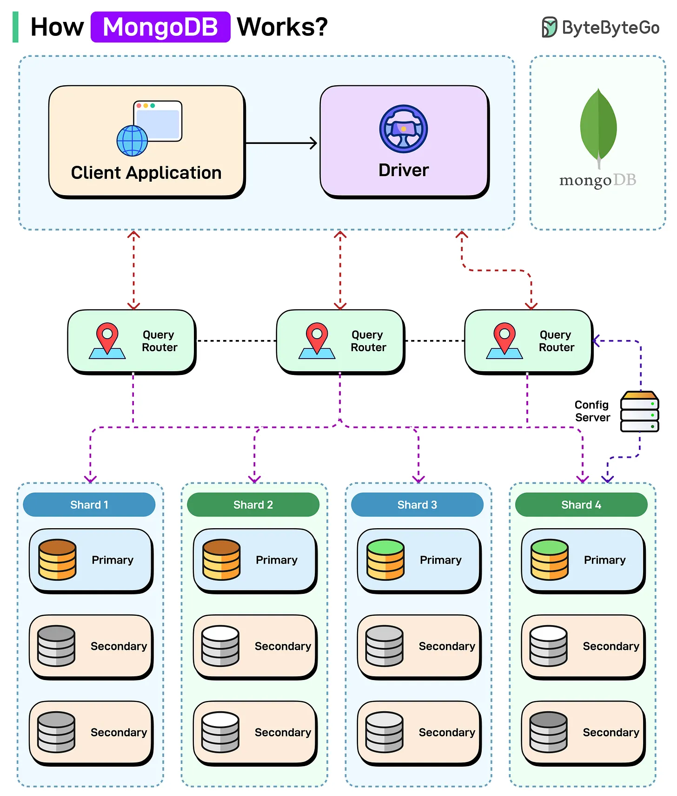

# 103 - How MongoDB Works?

- Source: ByteByteGo Big Archive System Design 2025
- PDF pages: 220-221
- Figures: 1

## Figures

## Original Extracted Text

MongoDB is a popular NoSQL database designed for flexibility, scalability, and high performance. It
stores data in a JSON-like format (BSON) and supports horizontal scaling through sharding and
replication.

Here's how it works:

   1. Client application connects via a MongoDB Driver to perform read/write operations.

   2. The Query Router (mongos) acts as a mediator, directing queries to the appropriate shard
       based on the data's shard key.

   3. Config servers store metadata and routing information. This helps query routers locate data
       across shards.

   4. The data is distributed across multiple shards to support horizontal scaling.

   5. Each shard is a replica set that consists of one primary node for handling writes and multiple
       secondary nodes for high availability and read scaling.

   6. If a primary fails, a secondary is automatically elected to replace it and maintain availability.

Over to you: What else will you add to understand MongoDB's working better?
