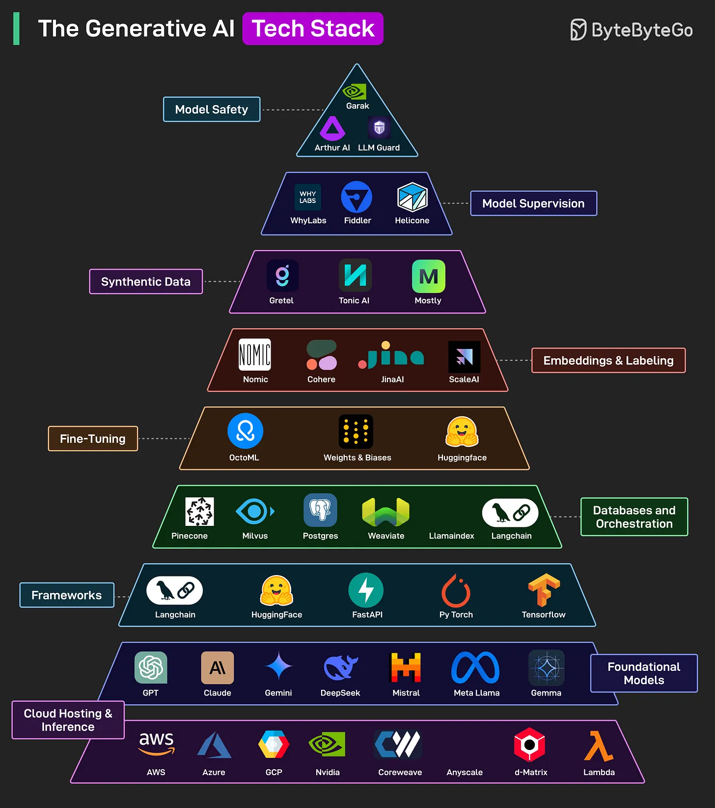

# 104 - The Generative AI Tech Stack

- Source: ByteByteGo Big Archive System Design 2025
- PDF pages: 222-223
- Figures: 1

## Figures

## Original Extracted Text

GenAI refers to systems capable of creating new content, such as text, images, code, or music, by
learning patterns from existing data. Here are the key building blocks for GenAI Tech Stack:

   1. Cloud Hosting & Inference: Providers like AWS, GCP, Azure, and Nvidia offer the
       infrastructure to run and scale AI workloads.

   2. Foundational Models: Core LLMs (such as GPT, Claude, Mistral, Llama, Gemini, Deepseek)
       trained on massive data, form the base for all GenAI applications.

   3. Frameworks: Tools like LangChain, PyTorch, and Hugging Face help build, deploy, and
       integrate models into apps.

    4. Databases and Orchestration: Vector DBs (such as Pinecone, Weaviate), orchestration tools
        (such as LangChain, LlamaIndex) manage memory, retrieval, and logic flow.

    5. Fine-Tuning: Platforms like Weights & Biases, OctoML, and Hugging Face enable training
        models for specific tasks or domains.

    6. Embeddings and Labeling: Services like Cohere, Scale AI, Nomic, and JinaAI help generate
        and label vector representations to power search and RAG systems.

    7. Synthetic Data: Tools like Gretel, Tonic AI, and Mostly AI create artificial datasets to enhance
        training.

    8. Model Supervision: Monitor model performance, bias, and behavior. Tools such as Fiddler,
        Helicone, and WhyLabs help.

    9. Model Safety: Helps ensure ethical, secure, and safe deployment of GenAI systems.
        Solutions like LLM Guard, Arthur AI, and Garak help with this.

Over to you: What else will you add to this list?
