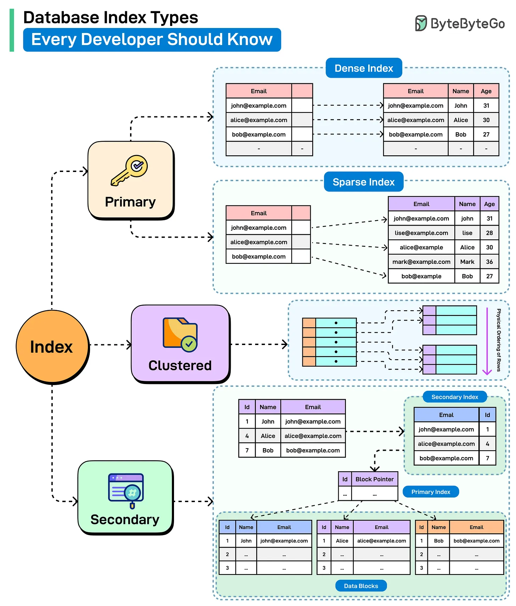

# 106 - Database Index Types Every Developer Should Know

- Source: ByteByteGo Big Archive System Design 2025
- PDF pages: 226-227
- Figures: 1

## Figures

## Original Extracted Text

A database index is a derived structure that maps column values to the physical locations of rows in
a table. Let's look at some key index types:

   1. Primary Index
       This index is automatically created when a primary key is defined on a table. Such an index
       can be dense as well as sparse, though sparse is preferred in most scenarios.
       A dense index contains one entry for every row in the table. On the other hand, a sparse
       index contains entries for only some rows in the table.

   2. Clustered Index
       A clustered index determines the physical order of rows in a table. Only one clustered index
       can exist on a table because data can only be stored in one order at a time. It is great for
       range queries, ordered scans, and I/O efficiency.

   3. Secondary Index
       A non-clustered index is a separate structure that holds a copy of one or more columns
       along with pointers to the actual rows in the table. It doesn't affect how data is physically
       stored, and it can use the primary index to locate the records.

Over to you: Which other index type will you add to the list?
