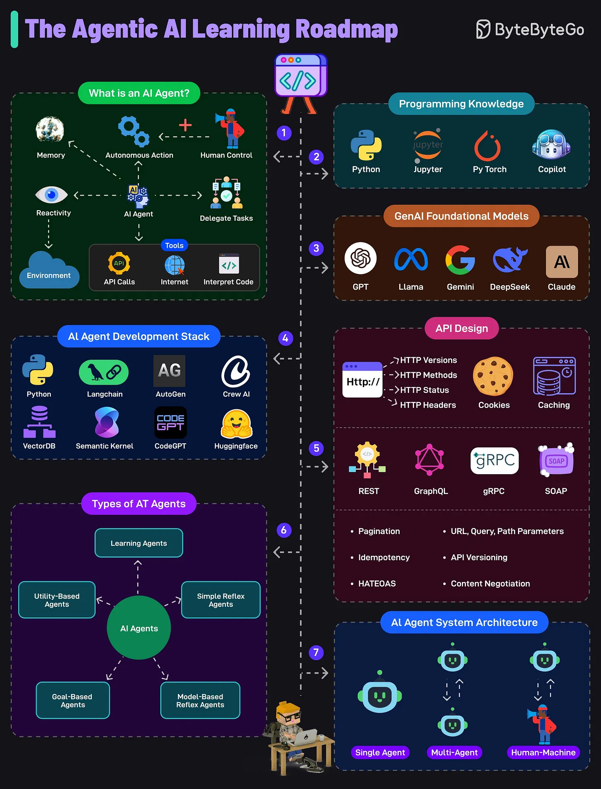

# 107 - The Agentic AI Learning Roadmap

- Source: ByteByteGo Big Archive System Design 2025
- PDF pages: 228-229
- Figures: 1

## Figures

## Original Extracted Text

1. An AI Agent is a system capable of autonomous actions, reacting to its environment, using
     tools (APIs, Internet, code, etc), and can work under human guidance.

 2. To build AI agents, one must know tools like Python, Jupyter, PyTorch, and GitHub Copilot.
     These enable coding, experimentation, and integration with AI libraries and APIs.

 3. GenAI Foundational Models
     Familiarity with large models like GPT, Gemini, LLaMa, DeepSeek, and Claude is essential.
     These models provide the base intelligence that agents can use for reasoning, generation,
     and understanding.

   4. AI Agent Development Stack
       Tools like Langchain, AutoGen, Crew AI, and frameworks like Semantic Kernel and Hugging
       Face power agent workflows. These components manage tasks, memory, and external tool
       integrations in agent pipelines.

   5. API Design
       Understanding API design approaches like REST, GraphQL, gRPC, and SOAP is crucial to
       building interoperable agents. Key concepts include HTTP methods, status codes,
       versioning, cookies, headers, and caching.

   6. Type of AI Agents
       Learn about the several types of AI agents, such as simple reflex, model-based reflex,
       goal-based, utility-based, and learning agents. Each varies in complexity.

   7. AI Agent System Architecture
       AI agents can operate as single agents, in multi-agent systems, or in human-machine
       collaboration. Architecture depends on the use case.

Over to you: What else will you add to the AI Agent Learning Roadmap?
