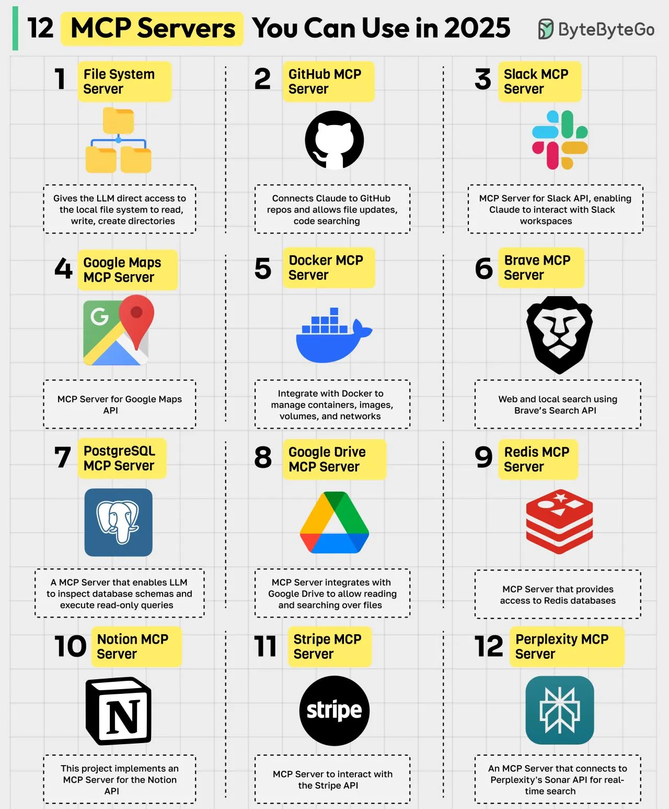

# 108 - 12 MCP Servers You Can Use in 2025

- Source: ByteByteGo Big Archive System Design 2025
- PDF pages: 230-231
- Figures: 1

## Figures

## Original Extracted Text

MCP (Model Context Protocol) is an open standard that simplifies how AI models, particularly LLMs,
interact with external data sources, tools, and services. An MCP server acts as a bridge between
these AI models and external tools. Here are the top MCP servers:

   1. File System MCP Server
       Allows the LLM to directly access the local file system to read, write, and create directories.

   2. GitHub MCP Server
       Connects Claude to GitHub repos and allows file updates, code searching.

   3. Slack MCP Server
       MCP Server for Slack API, enabling Claude to interact with Slack workspaces.

   4. Google Maps MCP Server
       MCP Server for Google Maps API.

   5. Docker MCP Server
       Integrate with Docker to manage containers, images, volumes, and networks.

   6. Brave MCP Server
       Web and local search using Brave's Search API.

   7. PostgreSQL MCP Server
       An MCP server that enables LLM to inspect database schemas and execute read-only
       queries.

   8. Google Drive MCP Server
       An MCP server that integrates with Google Drive to allow reading and searching over files.

   9. Redis MCP Server
       MCP Server that provides access to Redis databases.

   10.Notion MCP Server
       This project implements an MCP server for the Notion API.

   11. Stripe MCP Server
        MCP Server to interact with the Stripe API.

   12.Perplexity MCP Server
       An MCP Server that connects to Perplexity's Sonar API for real-time search.

Over to you: Which other MCP Server will you add to the list?
