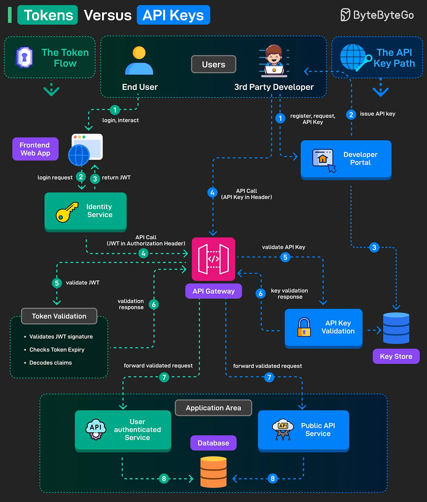

# 111 - Tokens vs API Keys

- Source: ByteByteGo Big Archive System Design 2025
- PDF pages: 236-237
- Figures: 1

## Figures

## Original Extracted Text

Both tokens (such as JWT) and API keys are used for authentication and authorization, but they
serve different purposes. Let's understand the simplified flow for both.

The Token Flow

   1. End user logs into the frontend web application.

   2. Login credentials are sent to the Identity Service.

   3. On successful authentication, a JWT token is issued and returned.

   4. The frontend makes API calls with the JWT in the Authorization header.

   5. API Gateway intercepts the request and validates the JWT (signature, expiry, and claims).

   6. If valid, the gateway sends a validation response.

   7. The validated request is forwarded to the user-authenticated service.

   8. The service processes the request and interacts with the database to return results.

The API Key Flow

   1. A 3rd party developer registers on the Developer Portal.

   2. The portal issues an API Key.

   3. The key is also stored in a secure key store for later verification.

   4. The developer app sends future API requests with the API Key in the header.

   5. The API Gateway intercepts the request and sends the key to the API Key Validation service.

   6. The validation service verifies the key from the key store and responds.

   7. For valid API keys, the gateway forwards the request to the public API service.

   8. The service processes it and accesses the database as needed.

Over to you: What else will you add to the explanation?
