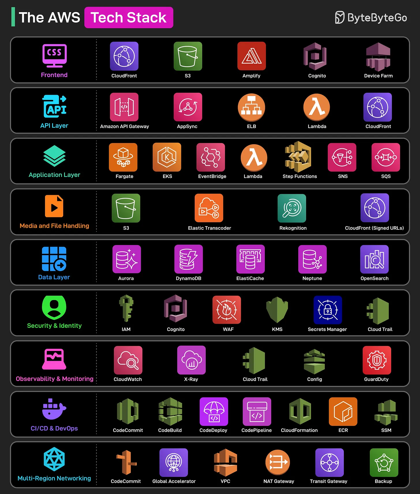

# 112 - The AWS Tech Stack

- Source: ByteByteGo Big Archive System Design 2025
- PDF pages: 238-239
- Figures: 1

## Figures

## Original Extracted Text

1. Frontend
     Static websites are hosted on S3 and served globally via CloudFront for low latency. Other
     services that support the frontend development include Amplify, Cognito, and Device Farm.

 2. API Layer
     API Gateway and AppSync expose REST and GraphQL APIs with built-in security and
     throttling. Other services that work in this area are Lambda, ELB, and CloudFront.

 3. Application Layer
     This layer hosts business logic. Some services that are important in this layer are Fargate,
     EKS, Lambda, EventBridge, Step Functions, SNS, and SQS.

    4. Media and File Handling
        Media is uploaded to S3, transcoded via Elastic Transcoder, and analyzed using Rekognition
        for moderation. CloudFront signed URLs ensure secure delivery of videos and files to
        authenticated users.

    5. Data Layer
        The primary services for this layer are Aurora, DynamoDB, ElastiCache, Neptune, and
        OpenSearch.

    6. Security and Identity
        Some AWS services that help in this layer of the stack are IAM, Cognito, WAF, KMS, Secrets
        Manager, and CloudTrail.

    7. Observability and Monitoring
        CloudWatch monitors logs, metrics, and alarms. X-Ray provides tracing of request paths.
        CloudTrail captures API calls. Config ensures compliance, and GuardDuty detects security
        threats.

    8. CI/CD and DevOps
        The key services used in this layer are CodeCommit, CodeBuild, CodeDeploy, CodePipeline,
        CloudFormation, ECR, and SSM.

    9. Multi-Region Networking
        Route 53 and Global Accelerator ensure fast DNS and global routing. VPC segments the
        network while NAT and Transit Gateways handle secure traffic flow. AWS Backup provides
        disaster recovery across regions.

Over to you: Which other service will you add to the list?
