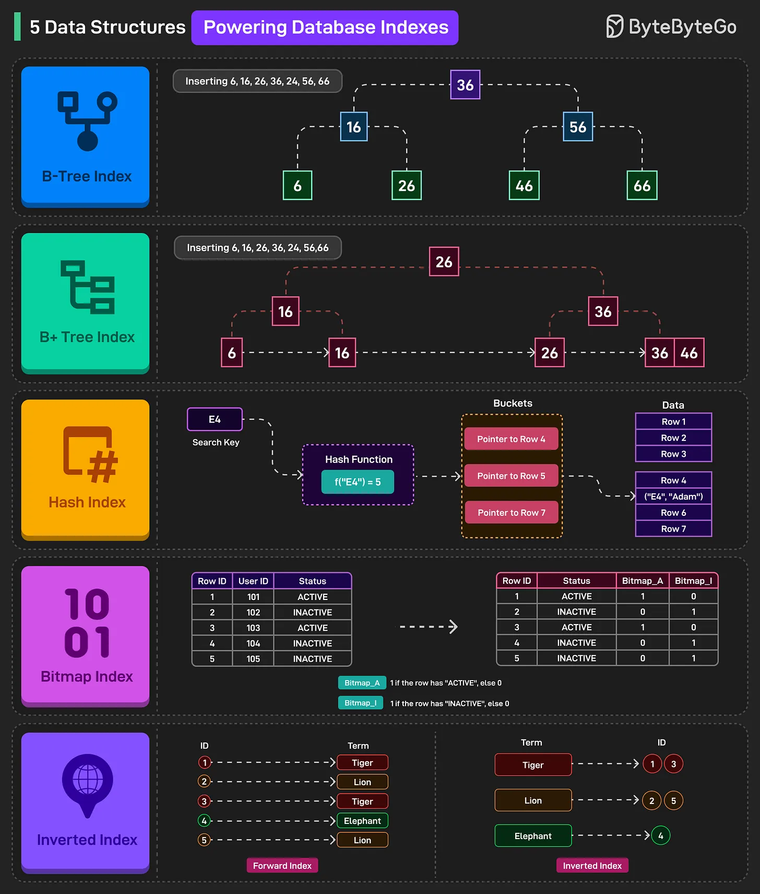

# 113 - 5 Data Structures That Make DB Queries Super Fast

- Source: ByteByteGo Big Archive System Design 2025
- PDF pages: 240-241
- Figures: 1

## Figures

## Original Extracted Text

Data structures are crucial for database indexes because they determine how efficiently data can be
searched, inserted, and retrieved, directly impacting query performance.

   1. B-Tree Index
       B-Tree indexes use a balanced tree structure where keys and data pointers exist in internal
       and leaf nodes. They support efficient range and point queries through ordered traversal.

   2. B+ Tree Index
       B+ Tree indexes store all data pointers in the leaf nodes, while internal nodes hold only keys
       to guide the search. Leaf nodes are linked for fast range queries via sequential access.

3. Hash Index
    Hash indexes apply a hash function to a search key to directly locate a bucket with pointers
    to data rows. They are optimized for equality searches but not for range queries.

4. Bitmap Index
    Bitmap indexes represent column values using bit arrays for each possible value, allowing
    fast filtering through bitwise operations. They're ideal for low-cardinality categorical data.

5. Inverted Index
    Inverted indexes map each unique term to a list of row IDs containing that term, enabling fast
    full-text search.
