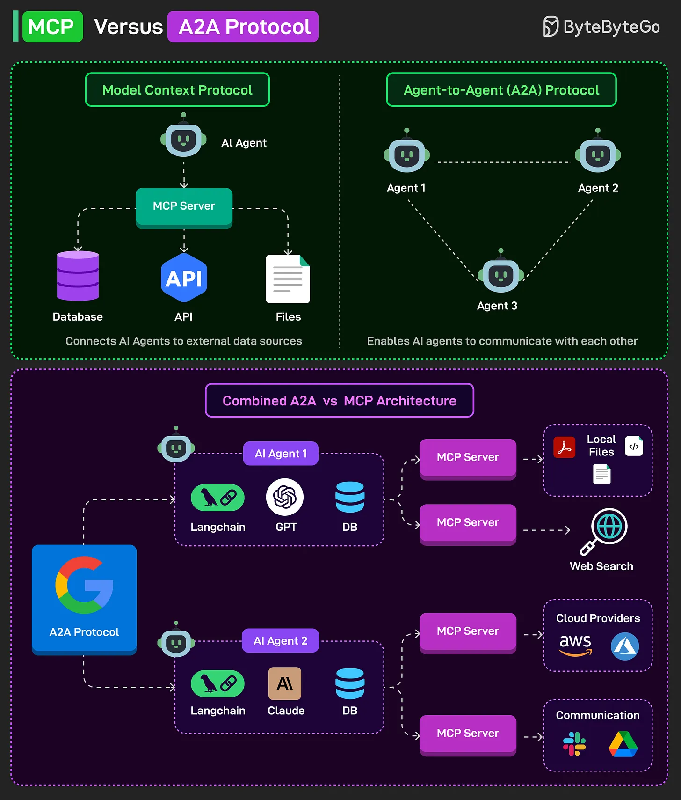

# 115 - MCP Versus A2A Protocol

- Source: ByteByteGo Big Archive System Design 2025
- PDF pages: 244-245
- Figures: 1

## Figures

## Original Extracted Text

The Model Context Protocol (MCP) connects AI agents to external data sources, such as databases,
APIs, and files, via an MCP server, thereby enriching their responses with real-world context.

Google's Agent-to-Agent (A2A) Protocol enables AI agents to communicate and collaborate,
allowing them to delegate tasks, share results, and enhance each other's capabilities.

MCP and A2A can be combined into a holistic architecture. Here's how it can work:

   1. Each AI agent (using tools like Langchain with GPT or Claude) connects to external tools via
       MCP servers for data access.

   2. The external tools can comprise cloud APIs, local files, web search, or communication
       platforms like Slack.

   3. Simultaneously, the AI agents can communicate with one another using the A2A protocol to
       coordinate actions, share intermediate outputs, and solve complex tasks collectively.

This architecture enables both rich external context (via MCP) and decentralized agent collaboration
(via A2A).

Over to you: What else will you add to understand the MCP vs A2A Protocol capabilities?
