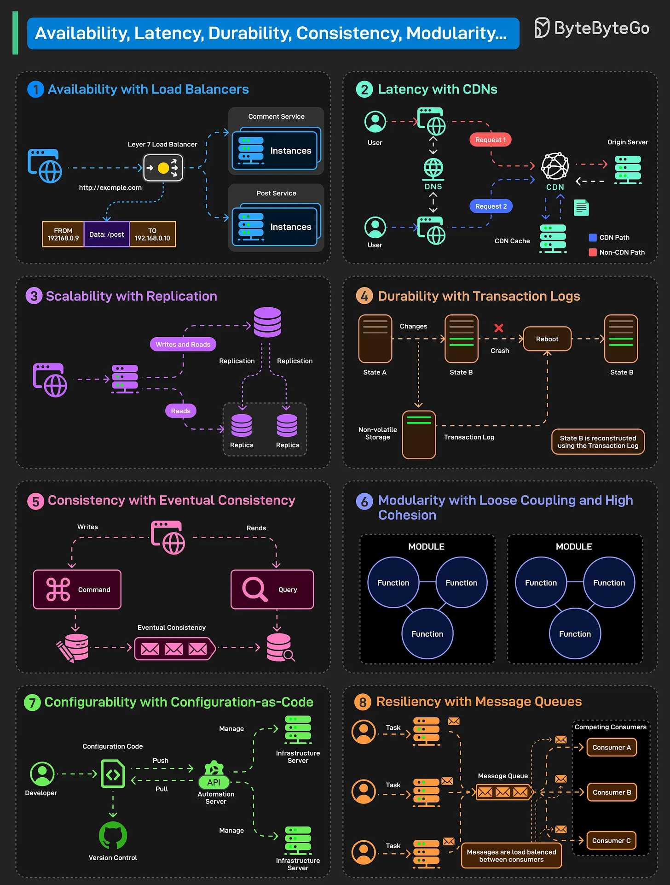

# 117 - 8 System Design Concepts Explained in 1 Diagram

- Source: ByteByteGo Big Archive System Design 2025
- PDF pages: 248-249
- Figures: 1

## Figures

## Original Extracted Text

Non-functional requirements define the quality attributes of a system that ensure it performs reliably
under real-world conditions. Some key NFRs, along with the implementation approach, are as
follows:

   1. Availability with Load Balancers
       Availability ensures that a system remains operational and accessible to users at all times.

       Using load balancers distributes traffic across multiple service instances to eliminate single
       points of failure

   2. Latency with CDNs
       Latency refers to the time delay experienced in a system's response to a user request. CDNs
       reduce latency by caching content closer to users.

   3. Scalability with Replication
       Scalability is the system's ability to handle increased load by adding resources. Replication
       distributes data across multiple nodes, enabling higher throughput and workload.

   4. Durability with Transaction Log
       Durability guarantees that once data is committed, it remains safe even in the event of
       failure. Transaction logs persist all operations, allowing the system to reconstruct the state
       after a crash.

   5. Consistency with Eventual Consistency
       Consistency means that all users see the same data. Eventual consistency allows temporary
       differences, but synchronizes replicas over time to a consistent state.

   6. Modularity with Loose Coupling and High Cohesion
       Modularity promotes building systems with well-separated and self-contained components.
       Loose coupling and high cohesion help achieve the same.

   7. Configurability
       Configurability allows a system to be easily adjusted or modified without altering core logic.
       Configuration-as-Code manages infra and app settings via version-controlled scripts.

   8. Resiliency with Message Queues
       Resiliency is a system's ability to recover from failures and continue operating smoothly.
       Message queues decouple components and buffer tasks, enabling retries.

Over to you: Which other NFR or strategy will you add to the list?
