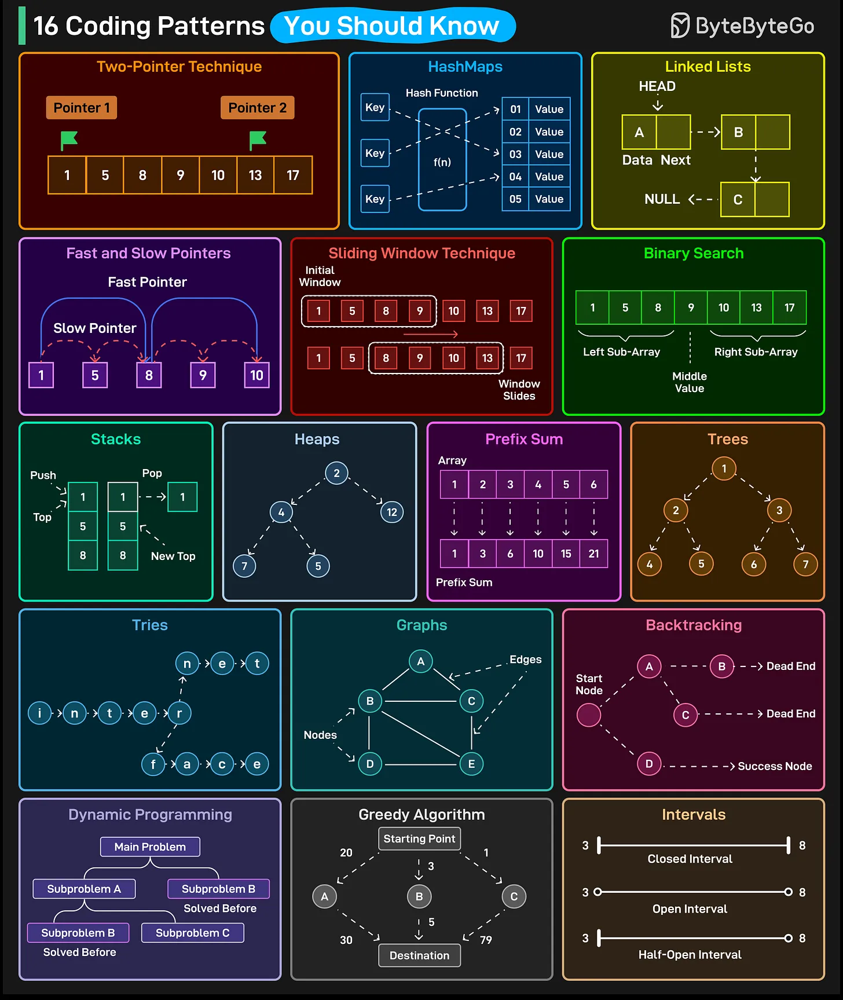

# 118 - 16 Coding Patterns That Make Interviews Easy

- Source: ByteByteGo Big Archive System Design 2025
- PDF pages: 250-251
- Figures: 1

## Figures

## Original Extracted Text

1. Two-Pointer Technique

 2. HashMaps

 3. Linked Lists

 4. Fast and Slow Pointers

 5. Sliding Window Technique

 6. Binary Search

 7. Stacks

   8. Heaps

   9. Prefix Sum

   10.Trees

   11. Tries

   12.Graphs

   13.Backtracking

   14.Dynamic Programming

   15.Greedy Algorithms

   16.Intervals

Over to you: Which other coding pattern will you add to the list?
