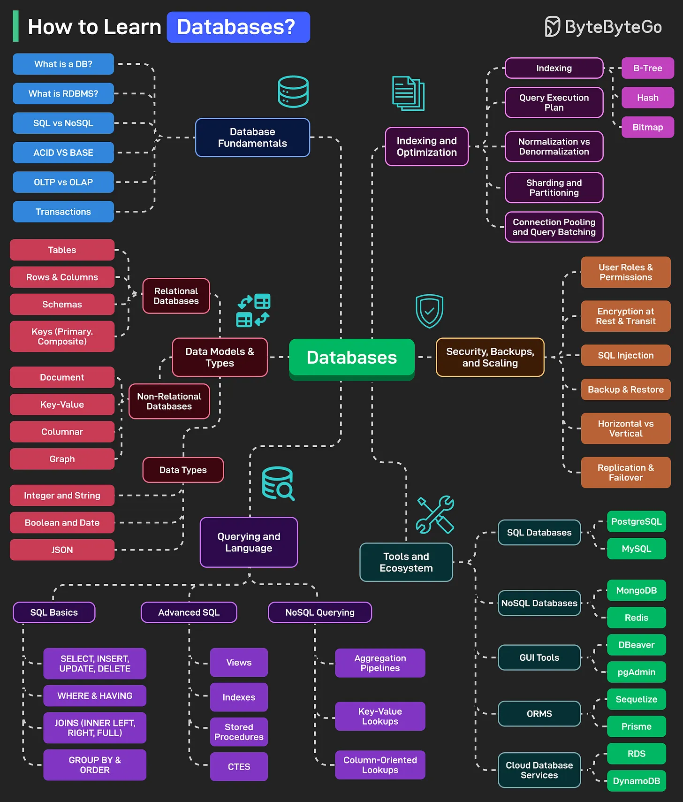

# 119 - How to Learn Databases?

- Source: ByteByteGo Big Archive System Design 2025
- PDF pages: 252-253
- Figures: 1

## Figures

## Original Extracted Text

Databases power everything from websites and apps to enterprise systems. Here's a learning map
that can help you master databases:

   1. Database Fundamentals
       This includes topics like "What is a database", RDBMS, SQL vs NoSQL, ACID vs BASE,
       OLTP vs OLAP, Transactions, and Isolation Levels.

   2. Data Models and Types
       Consists of topics like Relational Databases, Non-Relational Databases, and Data Types
       (Integer, String, Boolean, Date, JSON, etc).

   3. Querying and Language
       This includes topics like SQL Basics (SELECT, INSERT, etc), Advanced SQL (Views,
       Indexes, CTEs, etc), and NoSQL Querying (Aggregation and Key-Value Lookups).

   4. Indexing and Optimization
       Consists of topics like Indexing (B-Tree, Hash, and Bitmaps), Query Execution Plans,
       Denormalization vs Normalization, Sharding, Connecting Pooling, and Query Batching.

   5. Security, Backups, and Scaling
       This includes topics like User Roles, Permissions, Encryption, SQL Injection, High
       Availability (Replication and Failover), Horizontal vs Vertical Scaling.

   6. Tools and Ecosystem
       Consists of topics like Popular SQL Databases, NoSQL Database, GUI Tools, ORMs, Cloud
       DB services (RDS, DynamoDB, Google Cloud SQL, etc.)

Over to you: What else will you add to the list for learning databases?
