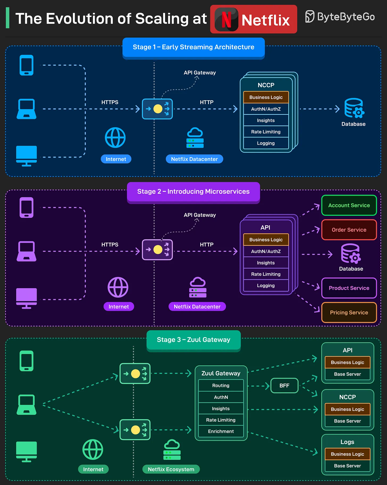

# 122 - The Evolution of Scaling at Netflix

- Source: ByteByteGo Big Archive System Design 2025
- PDF pages: 258-259
- Figures: 1

## Figures

## Original Extracted Text

Over the years, Netflix went through several growth stages. With each stage, they had to evolve the
scaling approach.

   1. Stage 1 (Early Streaming Architecture)
       It was a typical 3-tier consisting of a client, an API, and a database.

       The API application was named NCCP (Netflix Content Control Protocol). It was a monolithic
       application that contained all functionalities.

   2. Stage 2 (Introducing Microservices)
       As more features were added, maintaining the engineering velocity became critical. To

       support this, the monolithic application was broken up into microservices.

       Features were extracted from the NCCP application and developed as separate applications,
       but the orchestration logic remained in the NCCP application.

   3. Stage 3 (Zuul Gateway)
       Next, Netflix split the application. The NCCP stayed there for the playback experience while
       other APIs started to handle other features.

       A Zuul API Gateway was introduced to reduce the coupling between the client and the
       services.

Reference: Netflix TechBlog

Over to you: Have you come across any other nuance of how Netflix scaled to its current level?
