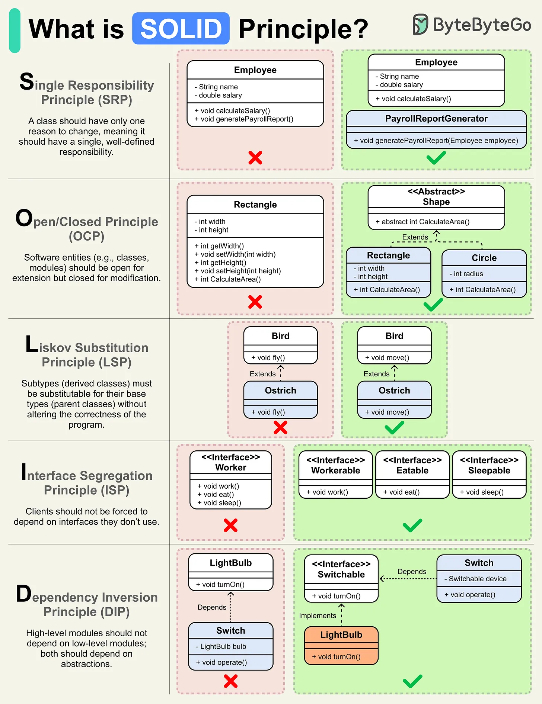

# 123 - What is the SOLID Principle?

- Source: ByteByteGo Big Archive System Design 2025
- PDF pages: 260-261
- Figures: 1

## Figures

## Original Extracted Text

SOLID offers guidelines to create software that is easy to understand, modify, and extend.

The SOLID acronym stands for:

S -> Single Responsibility Principle
O -> Open/Closed Principle
L -> Liskov Substitution Principle
I -> Interface Segregation Principle
D -> Dependency Inversion Principle

   ● The Single Responsibility Principle (SRP) states that a class should have only one reason to
      change. In other words, it should have a single, well-defined responsibility or task within a
      software system.

   ● The Open/Closed Principle (OCP) states that software entities, such as classes, should be
      open for extension but closed for modification. This means you can add new functionality
      without altering existing code.

   ● The Liskov Substitution Principle (LSP) states that objects of a derived class should be able
      to replace objects of the base class without affecting the correctness of the program.

   ● The Interface Segregation Principle (ISP) emphasizes that classes or components that use
      interfaces should not be forced to depend on interfaces they don't use.

   ● The Dependency Inversion Principle (DIP) states that high-level modules (or classes) should
      not depend on low-level modules; both should depend on abstractions, such as interfaces.

Over to you: Which SOLID principle do you find most useful or challenging in your daily development
work?
