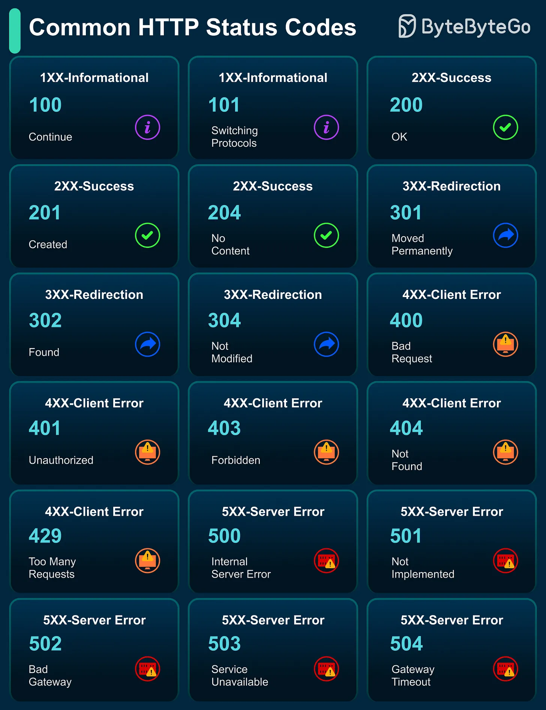

# 124 - Common HTTP Status Codes

- Source: ByteByteGo Big Archive System Design 2025
- PDF pages: 262-263
- Figures: 1

## Figures

## Original Extracted Text

HTTP status codes are issued by a server in response to a client's request. These concise
responses from servers are super useful when debugging our web apps, mobile apps, or APIs.

   ● 1xx Informational: Signals client's request received, and processing continues (e.g., 100
      Continue).

   ● 2xx Success: Confirms request was successfully completed (e.g., 200 OK).

   ● 3xx Redirection: Requires client action, like following redirects (e.g., 301 Moved
      Permanently).

   ● 4xx Client Error: Indicates client-caused request failures (e.g., 404 Not Found).

   ● 5xx Server Error: Shows server failures in processing requests (e.g., 500 Internal Server
      Error).

Over to you: Which category confuses you most, and why?
