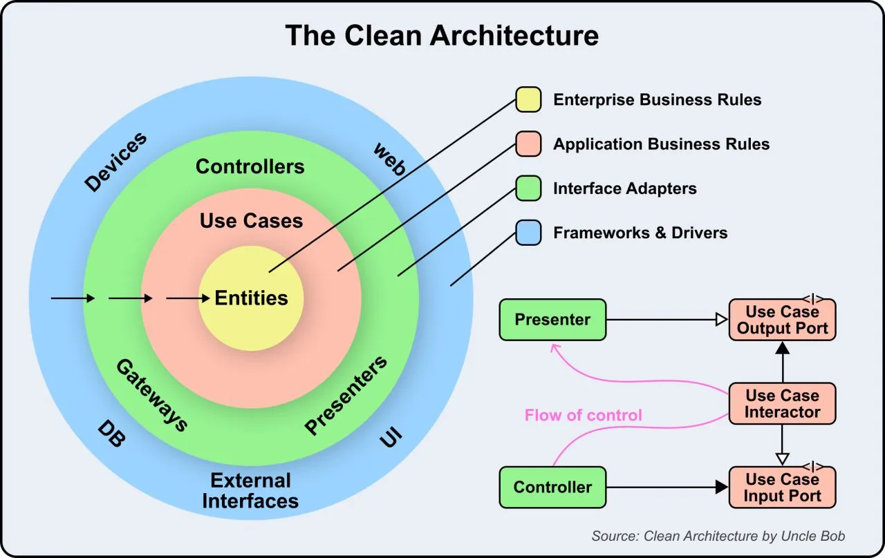

# 125 - How Clean Architecture Works?

- Source: ByteByteGo Big Archive System Design 2025
- PDF pages: 264-264
- Figures: 1

## Figures

## Original Extracted Text

Clean Architecture is a way of organizing software applications so that they are easy to understand,
maintain, and scale. Clean Architecture has 4 layers, each with a clear role. The dependencies
between these layers always point inward, ensuring a loosely coupled, testable, and maintainable
system.

Let's look at the layers:

    1. Entities: These are the core rules and logic of the business. They represent the most stable
        part of the system and are independent of any external systems or frameworks.

    2. Use Cases: These define the specific operations your application can perform. They
        orchestrate the flow of data between entities and external interfaces but don't care about
        how the data is displayed or stored.

    3. Interface Adapters: This layer includes Controllers, Presenters, and Gateways. It converts
        data from the outer layers (like the web, database, or UI) into a form that the use cases and
        entities can understand.

    4. Frameworks and Drivers: These are external tools and systems like the database, web UI, or
        devices. They sit on the outside and depend on the inner layers.

Over to you: What else will you add to understand the working of Clean Architecture?
