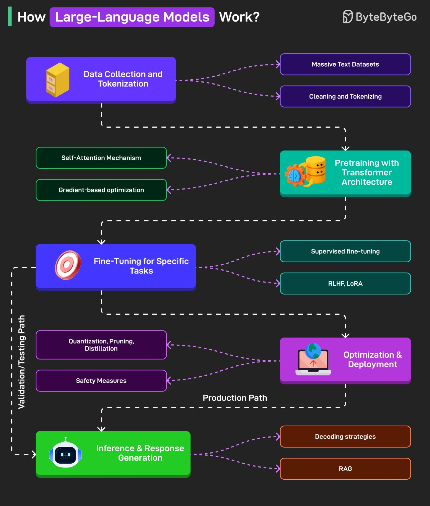

# 127 - How Large Language Models Work?

- Source: ByteByteGo Big Archive System Design 2025
- PDF pages: 266-267
- Figures: 1

## Figures

## Original Extracted Text

1. Data Collection and Tokenization.
     LLMs begin by ingesting massive volumes of text from sources like books, websites, and
     code. This text is cleaned and broken down into smaller units (tokens) to prepare it for
     training.

 2. Pre-training with Transformer Architecture
     Using the transformer model and self-attention mechanisms, the system learns to predict the
     next token in a sequence. This process adjusts billions of parameters to develop a broad
     understanding of language.

 3. Fine-Tuning for Specific Tasks
     The pretrained model is then tailored for specific applications through fine-tuning techniques,

       aligning its behavior with human preferences or specialized tasks. Some methods are RLHF,
       LoRA, and so on.

   4. Inference and Response Generation
       The model generates responses based on input prompts at inference time by predicting the
       next most likely tokens. Advanced strategies and retrieval mechanisms can improve fluency
       and factual accuracy.

   5. Optimization and Deployment
       Before deployment, the model is compressed and filtered to ensure speed, efficiency, and
       safety. It's then deployed in environments like cloud platforms and edge devices for
       real-world use.

Over to you: What else will you add to this high level flow?
