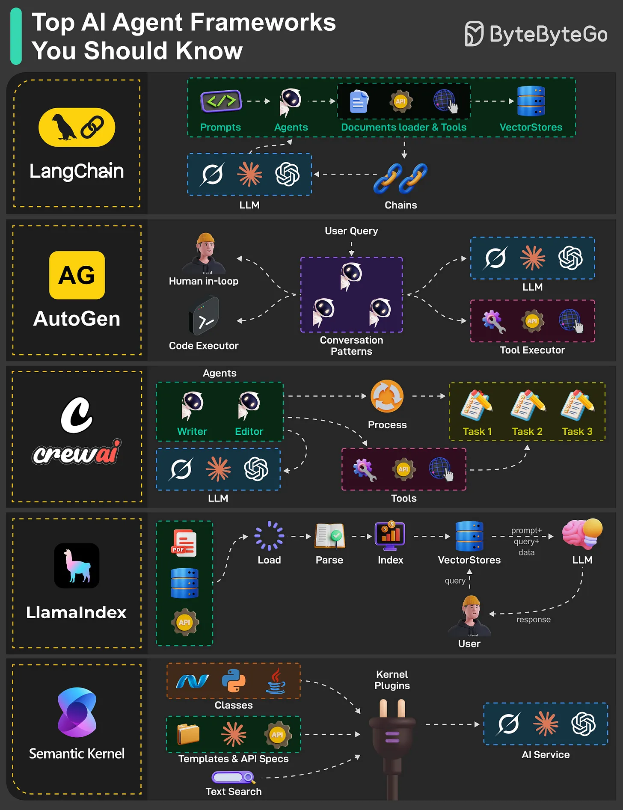

# 131 - Top AI Agent Frameworks You Should Know

- Source: ByteByteGo Big Archive System Design 2025
- PDF pages: 274-275
- Figures: 1

## Figures

## Original Extracted Text

Building smart, independent AI systems is easier with agent frameworks that combine large
language models (LLMs) with tools like APIs, web access, or code execution.

   ● LangChain
      LangChain makes it simple to connect LLMs with external tools like APIs and vector

       databases. It allows developers to create chains for sequential task execution and document
       loaders for context-aware responses.

   ● AutoGen
      AutoGen allows you to develop AI agents that can chat with each other or involve humans in
      the loop. It is like a collaborative workspace where agents can run code, pull in data from
      tools, or get human feedback to complete a task.

   ● CrewAI
      As the name suggests, CrewAI is all about teamwork. It orchestrates teams of AI agents with
      roles like writers and editors, processing tasks in a structured workflow. It utilizes LLMs and
      tools (APIs, Internet, code, etc) to efficiently manage complex task execution and data flow.

   ● LlamaIndex
      This framework indexes and queries data from documents, APIs, and vector stores to
      enhance agent responses. It parses and loads data, enabling LLMs to provide context-aware
      answers, making it ideal for enterprise document search systems and intelligent assistants
      that access private knowledge bases.

   ● Semantic Kernel
      Semantic Kernel connects AI services (OpenAI, Calude, Hugging Face models, etc) with a
      plugin-based architecture that supports skills, templates, and API integrations for flexible
      workflows. It supports text search and custom workflows for applications.

Over to you: Which AI agent framework have you explored or plan to use?
