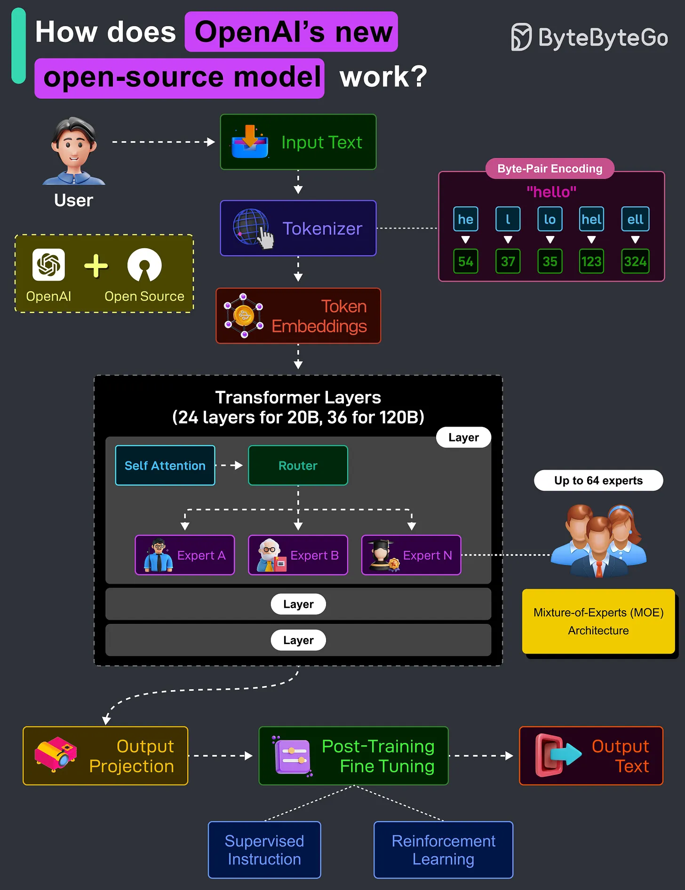

# 132 - How OpenAI's GPT-OSS 120B and 20B Models Work?

- Source: ByteByteGo Big Archive System Design 2025
- PDF pages: 276-277
- Figures: 1

## Figures

## Original Extracted Text

OpenAI has recently released two LLMs, GPT-OSS-120B (120 billion parameters) and
GPT-OSS-20B (20 billion parameters). These are fully open-source models and are provided under
an Apache 2.0 license.

These models aim to deliver strong real-world performance at low cost. Here's how they work:

   1. The user provides some input, such as a question or a task. For example, "Explain quantum
       mechanics in a simple manner".

   2. The raw text is converted into numerical tokens using Byte-Pair Encoding (BPE). BPE splits
       the text into frequently occurring subword units. Since it operates at the byte level, it can
       handle any input, including text, code, emojis, and more.

   3. Each token is mapped to a vector (a list of numbers) using a learned embedding table. This
       vectorized form is what the model understands and processes.

   4. Transformer layers are where the real computation happens. The 20B Model has 24
       Transformer layers, and the 120B Model has 36 Transformer layers. Each layer includes a
       self-attention module, router, and experts (MoE).

   5. The self-attention module lets the model understand relationships between words across the
       entire input.

   6. The LLM uses a Mixture-of-Experts (MOE) architecture. Instead of using all model weights
       like in traditional models, a router chooses the 2 best "experts" out of a pool of up to 64 total
       experts. Each expert is a small feedforward network trained to specialize in certain types of
       inputs. Only 2 experts are activated per token, thereby saving compute while improving
       quality.

   7. After passing through all layers, the model projects the internal representation back into
       token probabilities, predicting the next word or phrase.

   8. To make the raw model safe and helpful, it undergoes supervised fine-tuning and
       reinforcement learning.

   9. Finally, the model generates a response based on the predicted tokens, returning coherent
       output to the user based on the context.

Over to you: Have you used OpenAI's open-source models?
