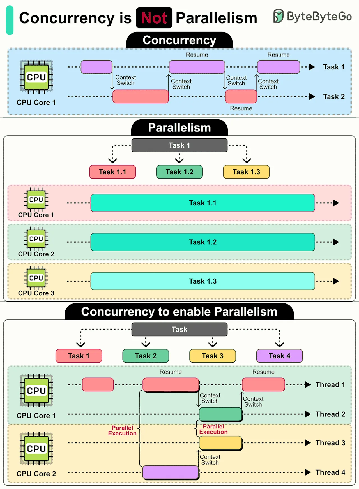

# 134 - Concurrency is NOT Parallelism

- Source: ByteByteGo Big Archive System Design 2025
- PDF pages: 280-281
- Figures: 1

## Figures

## Original Extracted Text

Concurrency: It's a design approach where tasks can start, run, and complete in overlapping
periods, even on a single CPU core. It is about managing multiple tasks at the same time.

The CPU rapidly switches between tasks (context switching), creating the illusion that tasks are
progressing simultaneously, though they are not.

Concurrency is great for tasks that involve waiting, like I/O operations. It allows other tasks to
progress during the wait, improving overall efficiency.

Parallelism: Refers to the simultaneous execution of multiple tasks, using multiple CPU cores.

Parallelism excels at heavy computations like data analysis or rendering graphics, where tasks can
be divided and run simultaneously on different cores.

How They Work Together

It's important to note that while concurrency and parallelism are different concepts, they are closely
related. A well-designed concurrent program can scale to use multiple cores for parallelism when
needed.

By understanding the differences and interplay between concurrency and parallelism, we can design
more efficient systems and create better-performing applications.

Over to you: Have you encountered any challenges with concurrency or parallelism?
