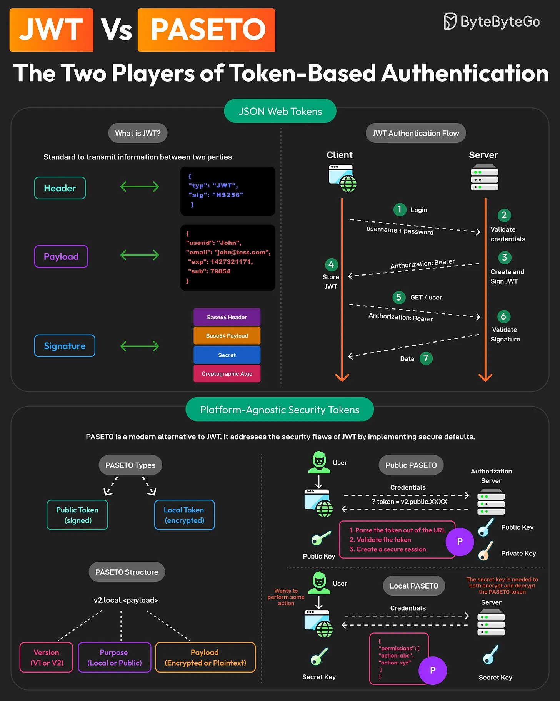

# 135 - JWT vs PASETO: The Two Players of Token-Based Authentication

- Source: ByteByteGo Big Archive System Design 2025
- PDF pages: 282-283
- Figures: 1

## Figures

## Original Extracted Text

Token-based authentication has become quite popular over the years. Traditionally, JWTs have
dominated this space.

But now, a new player is making waves: PASETO, or Platform-Agnostic Security Tokens.

So, what's the difference between the two?

   1. JWTs
       JWT or JSON Web Tokens is an open standard for securely transmitting information
       between two parties.

       A JWT consists of a Header, Payload, and Signature.

       JWTs can be used to implement stateless authentication between client and server
       applications.

   2. PASETO
       PASETO is a modern alternative to JWT. It addresses JWT's security flaws by implementing
       secure defaults.

       Unlike JWT, PASETO enforces strong, cryptographically sound algorithms, reducing the risk
       of vulnerabilities.

       A PASETO typically consists of Version, Purpose, and Payload. There are two types of
       PASETO:

          ○ Public PASETO: They are signed using asymmetric cryptography and ensure the
             integrity of the data, but not its confidentiality.

          ○ Local PASETO: They are encrypted using symmetric encryption algorithms, ensuring
             the confidentiality of the data contained within the token.

Over to you: Have you used JWTs or PASETO in your applications?
