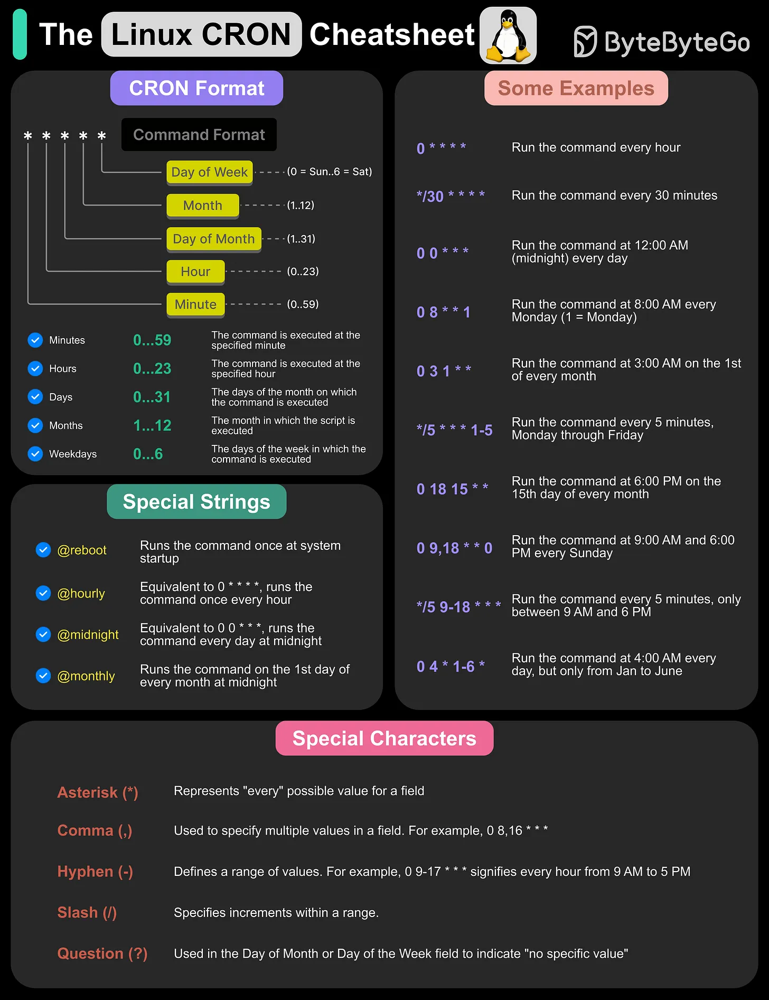

# 136 - The Linux Cron Cheatsheet

- Source: ByteByteGo Big Archive System Design 2025
- PDF pages: 284-285
- Figures: 1

## Figures

## Original Extracted Text

Cron is a time-based job scheduler that allows users to automate repetitive tasks by running
commands or scripts at specified intervals. It uses a Cron expression, a syntax defining the
schedule, which consists of five fields (minute, hours, day, month, weekday).

Cron is widely for system maintenance, backups, log rotation, and automation of tasks like sending
emails or running scripts at regular intervals. In this cheatsheet, we cover:

   1. The Cron Format

   2. Some Cron Examples

   3. Special Cron Strings

   4. Special characters

Over to you: Have you used Cron?
