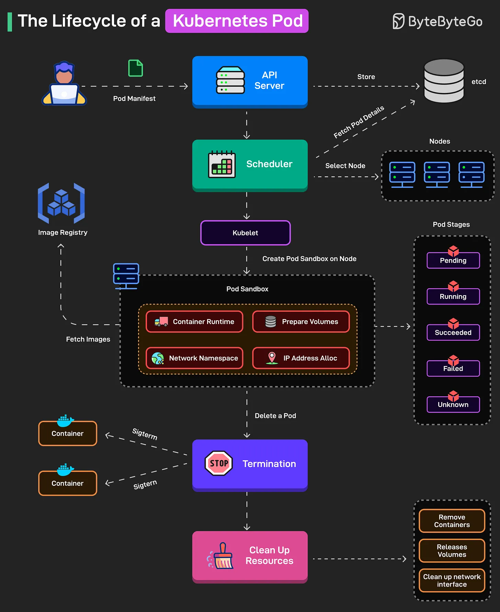

# 138 - The Lifecycle of a Kubernetes Pod

- Source: ByteByteGo Big Archive System Design 2025
- PDF pages: 288-289
- Figures: 1

## Figures

## Original Extracted Text

The Pod manifest is submitted to the API server and stored in etcd.

   1. The scheduler selects a node for the Pod based on resources, affinity rules, and binds the
       Pod to that node.

   2. The kubelet prepares the Pod by creating its network namespace, assigning an IP, mounting
       volumes, and pulling images if needed.

   3. Containers move from Waiting to Running, with kubelet monitoring health probes for liveness
       and readiness.

   4. Kubernetes tracks the Pod's high-level phase from Pending to Running to
       Succeeded/Failed/Unknown.

   5. Upon termination, Kubernetes sends SIGTERM (and SIGKILL if needed) for the individual
       containers in the Pod.

   6. After termination, the resources are cleaned up, and the Pod details are removed from etcd.

Over to you: What else will you add to understand the Kubernetes Pod Lifecycle?
