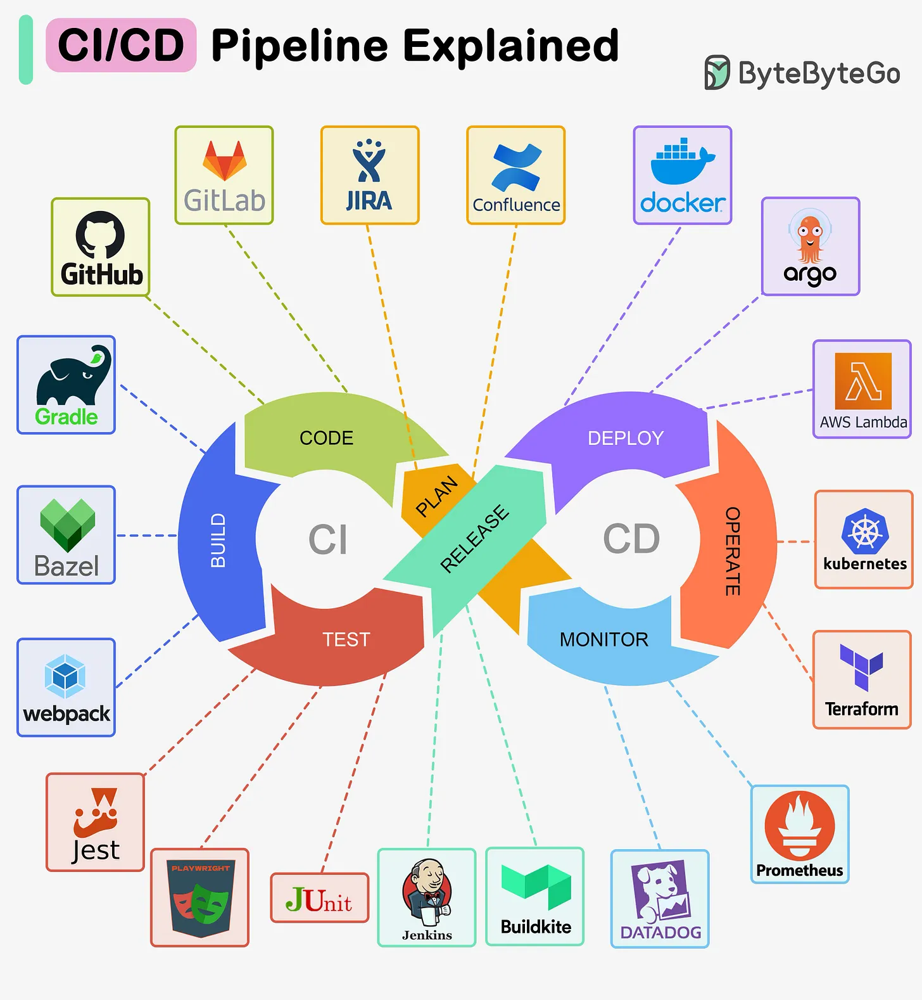

# 139 - CI/CD Pipeline Explained

- Source: ByteByteGo Big Archive System Design 2025
- PDF pages: 290-290
- Figures: 1

## Figures

## Original Extracted Text

A CI/CD pipeline is a tool that automates the process of building, testing, and deploying software.

It integrates the different stages of the software development lifecycle, including code creation and
revision, testing, and deployment, into a single, cohesive workflow.

The diagram below illustrates some of the tools that are commonly used.
