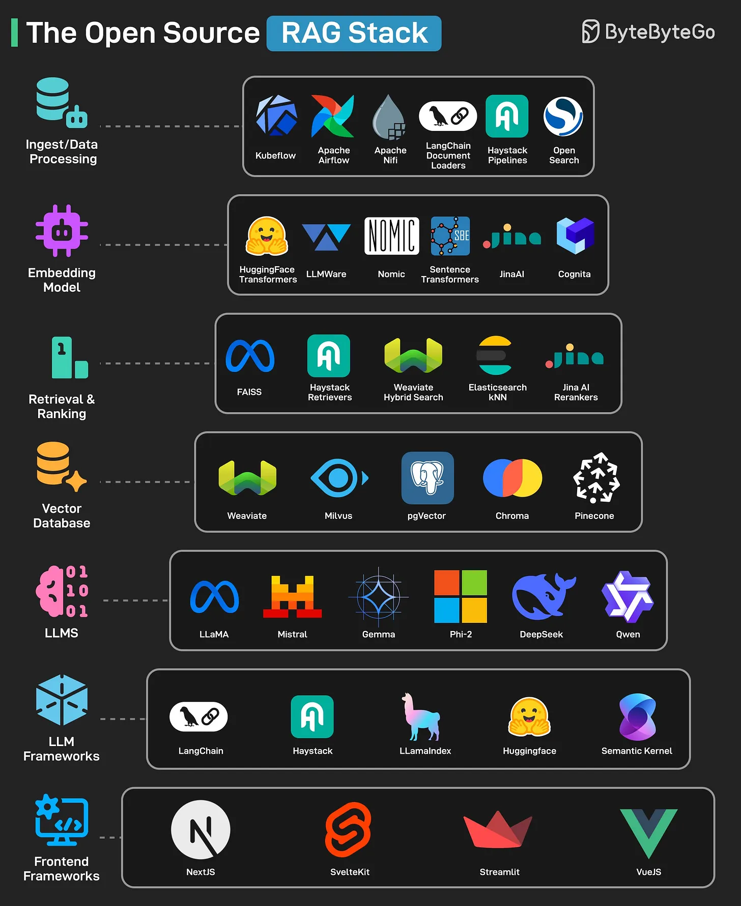

# 140 - The Open Source RAG Stack

- Source: ByteByteGo Big Archive System Design 2025
- PDF pages: 291-292
- Figures: 1

## Figures

## Original Extracted Text

1. Frontend Frameworks: Used to build frontend interfaces for the RAG apps. Some tools that
     can help are NextJS, VueJS, SvelteKit, and Streamlit.

 2. LLM Frameworks: High-level orchestration of LLM pipelines, prompts, and chains. This
     includes tools such as LangChain, LlamaIndex, Haystack, HuggingFace, and Semantic
     Kernel.

 3. LLMs: Generates final responses using large language models. Some open-source options
     include Llama, Mistral, Gemma, Phi-2, DeepSeek, Qwen, etc.

   4. Retrieval and Ranking: Retrieves relevant chunks and ranks them based on relevance. Tools
       like Meta FAISS, Haystack Retrievers, Weaviate Hybrid Search, ElasticSearch kNN, and
       JinaAI Rerankers can help.

   5. Vector Database: Stores and enables similarity search over vector embeddings. Common
       options include Weaviate, Milvus, Postgres pgVector, Chroma, and Pinecone.

   6. Embedding Mode: Converts text/data into vector representations using ML. Some
       open-source tools include HuggingFace Transformers, LLMWare, Nomic, Sentence
       Transformers, JinaAI, and Cognita.

   7. Ingest/Data Processing: Extracts, cleanses, and prepares raw data for indexing and retrieval.
       Tools like Kubeflow, Apache Airflow, Apache NiFi, LangChain Document Loads, Haystack
       Pipelines, and OpenSearch can help.

Over to you: Which other open-source tool will you add to the list?
