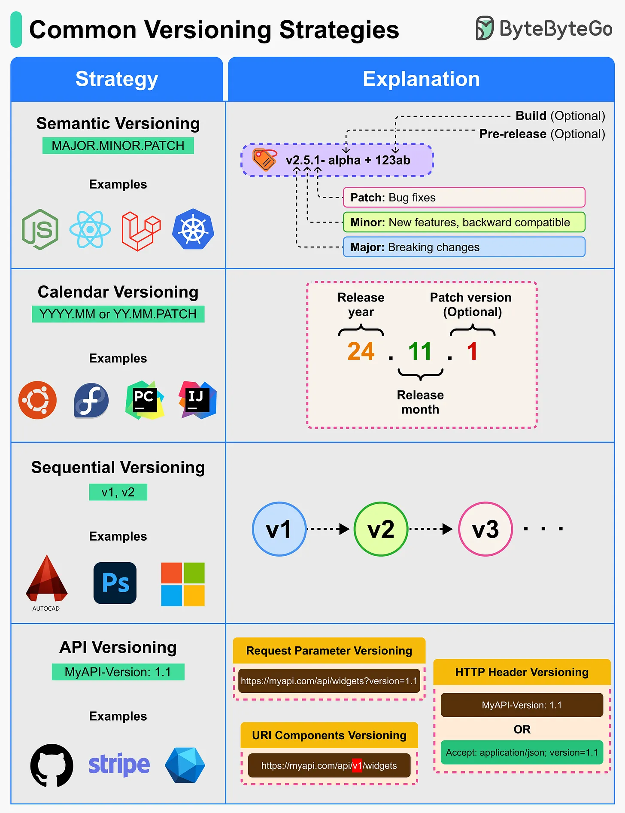

# 141 - What are some of the most popular versioning strategies?

- Source: ByteByteGo Big Archive System Design 2025
- PDF pages: 293-293
- Figures: 1

## Figures

## Original Extracted Text

Versioning helps developers communicate release changes clearly, whether it's for software
packages, APIs, or operating systems.

   ● Semantic Versioning (SemVer): A versioning scheme that conveys meaning about the scope
      of changes in a release using the format MAJOR.MINOR.PATCH.

   ● Calendar Versioning (CalVer): A scheme that uses the release date (year and month) as the
      version number to indicate when the release occurred.
