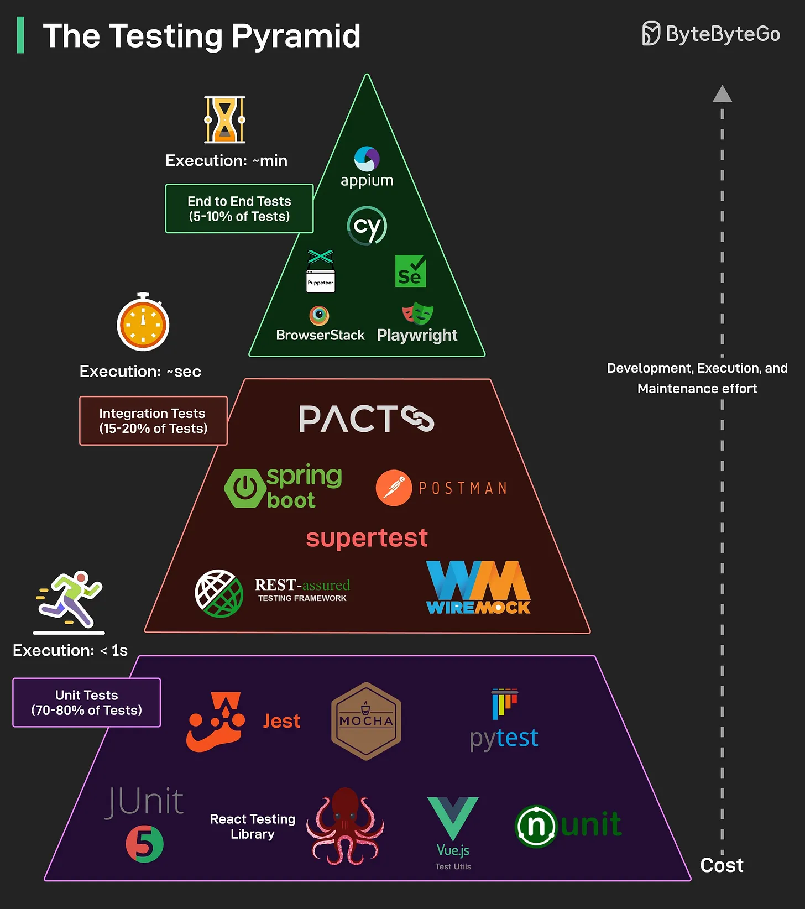

# 142 - The Testing Pyramid

- Source: ByteByteGo Big Archive System Design 2025
- PDF pages: 294-294
- Figures: 1

## Figures

## Original Extracted Text

Testing is the backbone of reliable software. The Testing Pyramid is a widely accepted strategy for
structuring tests into three key layers:

   ● Unit Tests: These are the foundation of the pyramid. Unit tests are fast, isolated, and
      low-cost to write and maintain. They test individual functions, methods, or components.

   ● Integration Tests: These tests validate interactions between components, such as APIs,
      databases, and external services. They are slower than unit tests and require more setup.

   ● E2E Tests: These simulate real user flows from start to finish across the full system. They
      are expensive to write and maintain and tend to be slow to execute.

As you go up the pyramid, the cost of test development, execution, and maintenance increases.

Over to you: Which layer do you find most valuable in your testing strategy, and why?
