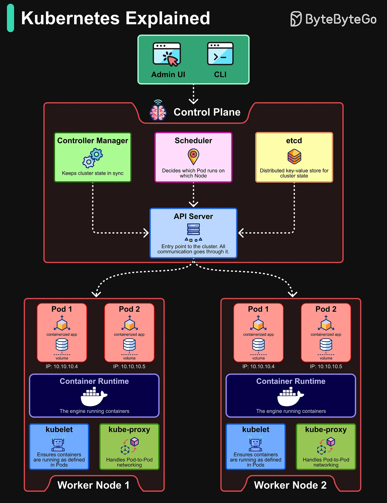

# 144 - Kubernetes Explained

- Source: ByteByteGo Big Archive System Design 2025
- PDF pages: 297-298
- Figures: 1

## Figures

## Original Extracted Text

Kubernetes is the de facto standard for container orchestration. It automates the deployment,
scaling, and management of containerized applications.

Control Plane:

   ● API Server: Acts as the communication hub between users, the control plane, and worker
      nodes.

   ● Scheduler: Decides which Pod runs on which Node.

   ● Controller Manager: Keeps the cluster state in sync.

   ● etcd: A distributed key-value store that holds the cluster's state.

Worker Nodes:

   ● Pods: The smallest deployable unit in Kubernetes, representing one or more containers.

   ● Container Runtime: The engine (like Docker or containerd) that runs the containers.

   ● kubelet: Ensures containers are running as defined in Pods.

   ● kube-proxy: Handles networking between Pods and ensures communication.
