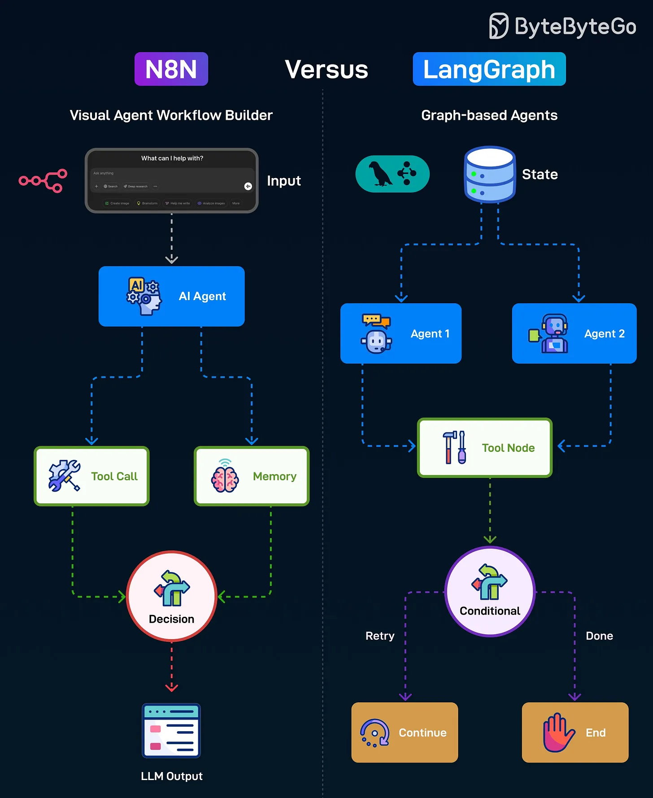

# 145 - N8N versus LangGraph

- Source: ByteByteGo Big Archive System Design 2025
- PDF pages: 299-300
- Figures: 1

## Figures

## Original Extracted Text

N8N is an open-source automation tool that lets you visually build workflows by connecting different
services, APIs, and AI tools in a sequence. Here's how it works:

   1. Starts with Input from the user.

   2. Passes it to an AI Agent for processing.

   3. The AI Agent can either make a Tool Call or access Memory.

   4. A Decision node chooses the next action and produces the final LLM output for the user.

LangGraph is a Python framework for building AI Agent workflows using a flexible graph structure
that supports branching, looping, and multi-agent collaboration. Here's how it works:

   1. Starts with a shared State containing workflow context.

   2. Can route tasks to different agents.

   3. Agents interact with a Tool Node to perform tasks.

   4. A Conditional node decides whether to retry or mark the process done.

Over to you: Have you used N8N or LangGraph?
