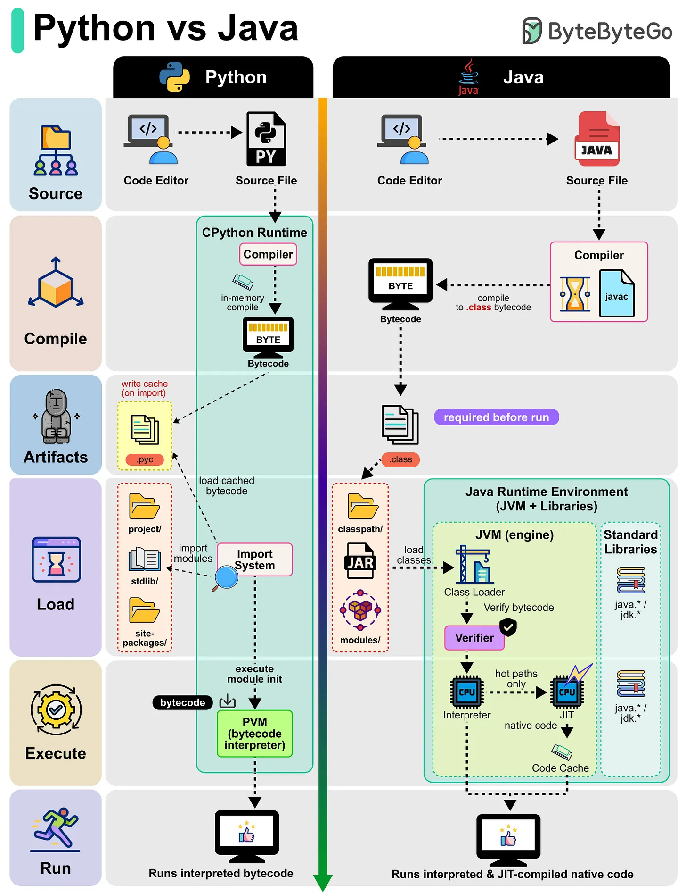

# 147 - Python vs Java

- Source: ByteByteGo Big Archive System Design 2025
- PDF pages: 303-304
- Figures: 1

## Figures

## Original Extracted Text

Ever wondered what happens behind the scenes when you run a Python script or a Java program?
Let's find out:

Python (CPython Runtime):

   ● Python source code (.py) is compiled into bytecode automatically in memory.

   ● Bytecode can also be cached in .pyc files, making re-runs faster by using the cached
      version.

   ● The Import System loads modules and dependencies.

   ● The Python Virtual Machine (PVM) interprets the bytecode line by line, making Python
      flexible but relatively slower.

Java (JVM Runtime):

   ● Java source code (.java) is compiled into .class bytecode using javac.

   ● The Class Loader loads bytecode into the Java Runtime Environment (JVM).

   ● Bytecode is verified and executed.

   ● JVM uses both an Interpreter and a JIT Compiler, frequently used code (hot paths) is
      converted into native machine code, making Java faster.
